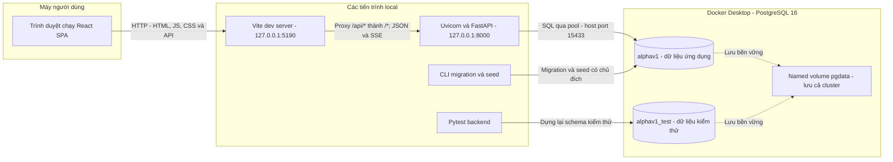
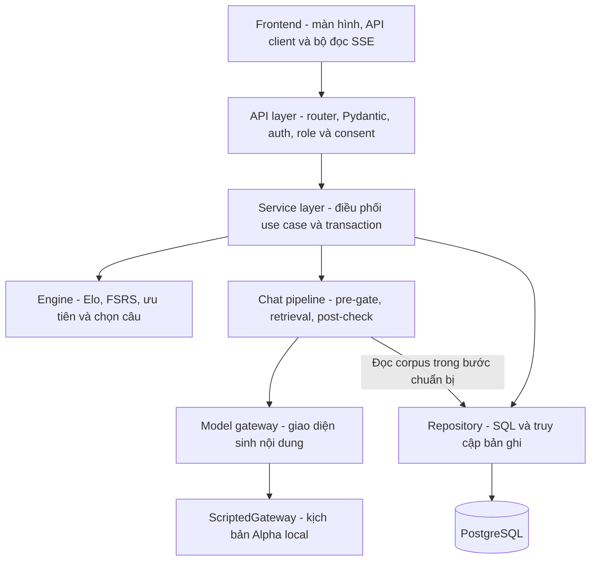
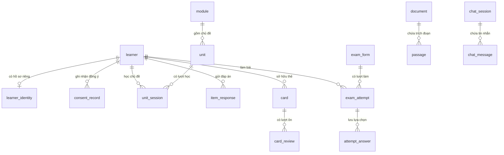
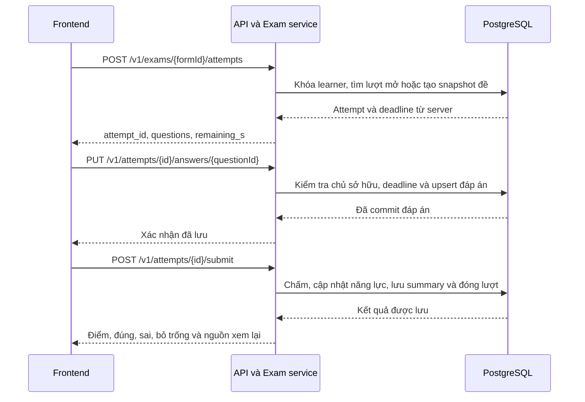
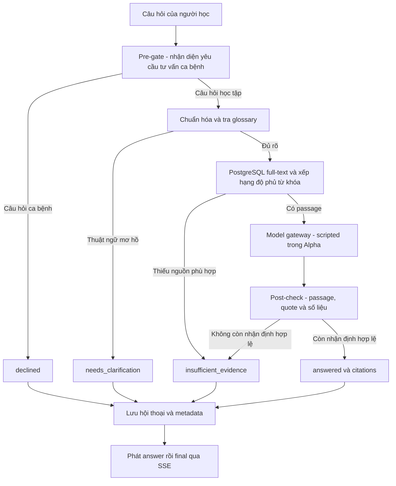
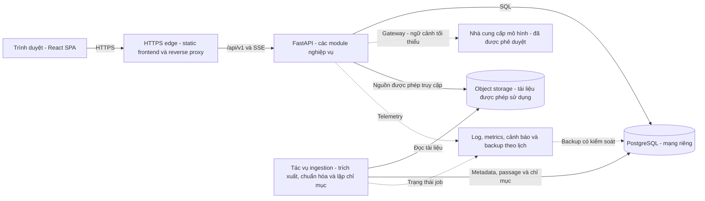

# Thiết kế kiến trúc hệ thống AI Tutor / DocPrep

**Phiên bản tài liệu:** 1.0  
**Ngày thiết kế:** 26/10/2026  
**Phạm vi:** nền tảng học và ôn thi năng lực hành nghề Y học dự phòng, từ Alpha V1 local đến kiến trúc đề xuất cho pilot.  
**Cơ sở thiết kế:** mã nguồn frontend/backend, migration, OpenAPI và cấu hình trong repository hiện tại.

> Các mục 1–9 mô tả kiến trúc Alpha V1 đã triển khai trong repo và các giới hạn của nó. Mục 10 mô tả kiến trúc đề xuất sau Alpha, chưa được triển khai. Tài liệu thiết kế không thay thế báo cáo kiểm thử runtime.

## 1. Mục tiêu và quyết định kiến trúc

Hệ thống hỗ trợ người học theo một chu trình: chọn học phần, học nội dung, trả lời câu hỏi, nhận phản hồi, ôn thẻ, thi thử, theo dõi tiến độ và hỏi gia sư có trích dẫn nguồn. Cán bộ được cấp quyền xem số liệu tổng hợp; quản trị viên quản lý môi trường và tài khoản theo phạm vi được mở.

Kiến trúc được chọn là **backend nguyên khối chia module — modular monolith**: một ứng dụng FastAPI triển khai chung, bên trong tách theo nghiệp vụ. Cách tổ chức này phù hợp với nhóm nhỏ, cho phép tái sử dụng backend demo và giữ các cập nhật đáp án, năng lực, thẻ ôn trong cùng transaction.

| Quyết định | Thiết kế được chọn | Mục đích |
|---|---|---|
| Giao diện | React + TypeScript; Vite phục vụ môi trường local | Tận dụng frontend đã thiết kế và kiểm tra kiểu dữ liệu khi tích hợp |
| Backend | Python 3.13, FastAPI, Pydantic | Tổ chức API có schema, validation và OpenAPI |
| Lưu trữ | PostgreSQL 16, truy vấn qua psycopg và connection pool | Lưu bền vững dữ liệu quan hệ, transaction và ràng buộc toàn vẹn |
| Thay đổi schema | Alembic; chuỗi migration `0001`–`0012` | Tái tạo và nâng cấp database có kiểm soát |
| Hợp đồng tích hợp | API `/v1`, JSON và POST SSE | Đồng bộ frontend/backend; truyền trạng thái xử lý hội thoại |
| Thuật toán học | Module engine: Elo, ưu tiên học, FSRS, phiên học và chọn câu | Tính điểm và lịch ôn bằng quy tắc có thể kiểm thử |
| AI trong Alpha | `ScriptedGateway`, `MODEL_PROVIDER=scripted` | Trình diễn pipeline có nguồn mà không gọi API mô hình |
| Dashboard | Truy vấn và tổng hợp trên PostgreSQL | Giữ số liệu và chính sách ẩn nhóm nhỏ ở server |

## 2. Tác nhân và phạm vi chức năng

| Tác nhân | Quyền và chức năng | Trạng thái Alpha |
|---|---|---|
| Người học — `learner` | Kích hoạt, consent, hồ sơ, học, ôn, thi, tiến độ, chat | Được tích hợp với backend thật |
| Cán bộ xem báo cáo — `ministry_viewer` | Xem dashboard và các thao tác báo cáo được API cấp quyền | Đã có đăng nhập và dashboard |
| Quản trị viên — `admin` | Truy cập khu vực quản trị và dashboard; tài khoản được tạo bằng CLI/seed | Dashboard hoạt động; CSV chưa được mở |
| Chuyên gia — `reviewer` | Thẩm định nội dung theo vòng duyệt | Có mô hình role và dữ liệu; API workbench còn stub, chưa thuộc Alpha |

Alpha sử dụng nội dung và cohort minh họa. Seed có thể tạo các bản ghi trạng thái đã duyệt phục vụ demo; trạng thái này không chứng minh nội dung đã được chuyên gia y khoa thẩm định thực tế.

Ngoài phạm vi Alpha: nhập CSV, bàn duyệt chuyên gia, tạo lượt luyện tự chọn, toàn bộ thư viện thẻ, đồng bộ bookmark/thông báo/lộ trình, OCR, tìm kiếm vector, mô hình AI thật và triển khai online. Repo hiện có **55 API nghiệp vụ, gồm 7 handler stub trả `501`**; xem [ma trận API](api-matrix.md).

## 3. Kiến trúc tổng thể Alpha V1

### 3.1. Sơ đồ triển khai local

Hai database tách tên và dữ liệu nhưng cùng nằm trong một container/cluster local. Đây là cách ly môi trường kiểm thử trong Alpha, chưa phải hai hạ tầng độc lập. Pytest không được trỏ vào database đang dùng để trình diễn.

### 3.2. Điểm truy cập và định tuyến

| Thành phần | Địa chỉ/path | Trách nhiệm |
|---|---|---|
| Frontend local | `http://127.0.0.1:5190` | Phục vụ giao diện và chuyển tiếp API |
| API qua frontend | `/api/v1/*` | URL mà client hiện sử dụng |
| Backend trực tiếp | `http://127.0.0.1:8000/v1/*` | Xử lý nghiệp vụ và quyền dữ liệu |
| Runtime health | Backend `/health`, qua Vite là `/api/health` | Báo mode/provider và nhãn dữ liệu minh họa |
| Hợp đồng API | Backend `/openapi.json`, `/docs` | Schema và tài liệu tương tác |
| PostgreSQL | Host `127.0.0.1:15433` → container `5432` | Kết nối database của dự án |

Ví dụ: frontend gọi `GET /api/v1/me`; Vite bỏ `/api` và chuyển `GET /v1/me` tới FastAPI. Proxy này thuộc Vite dev server. Bản frontend build tĩnh cần có reverse proxy tương ứng khi đưa lên staging.

`vercel.json` hiện chỉ có SPA fallback về `index.html`, chưa cấu hình đường đi API production. `/health` hiện là thông tin liveness/runtime; nó không thực hiện truy vấn kiểm tra database trên từng request. Backend kiểm tra database và revision schema lúc khởi động.

## 4. Kiến trúc logic và phân lớp backend

Các khối trong sơ đồ là module trong cùng ứng dụng backend; không phải các service triển khai riêng.

| Lớp | Nội dung | Nguyên tắc |
|---|---|---|
| Frontend | Hiển thị, tương tác, token/session, retry, đọc stream | Gửi lựa chọn của người học và hiển thị kết quả server |
| API | Method/path, schema vào/ra, dependency, mã lỗi | Kiểm tra xác thực, role và consent trước use case được bảo vệ |
| Service | Học, thi, ôn, chat, hồ sơ, dashboard | Phối hợp repository và engine để giữ trạng thái nghiệp vụ nhất quán |
| Engine | Quy tắc tính năng lực, lịch ôn, thứ tự học và chọn câu | Hàm tính toán tách khỏi HTTP và provider mô hình |
| Chat pipeline | Chuẩn hóa câu hỏi, truy xuất, kiểm tra bằng chứng | Quyết định các trạng thái trả lời và nguồn được hiển thị |
| Gateway | Giao diện `complete(...)`, metadata model/prompt/chi phí | Cô lập tích hợp mô hình; Alpha chọn provider scripted |
| Repository | Đọc/ghi SQL, khóa bản ghi, tổng hợp dữ liệu | Nhận connection theo transaction của use case |

Repo đã có adapter gọi nhà cung cấp mô hình trong `gateway.py`. Luồng Alpha hiện chọn `scripted_gateway.py`; adapter bên ngoài chưa được nghiệm thu như AI thật của sản phẩm.

### Các module nghiệp vụ

| Module | Trách nhiệm | Nhóm API tiêu biểu |
|---|---|---|
| Identity và consent | Activation code, staff login, refresh/logout, hồ sơ, đồng ý dịch vụ | `/auth/*`, `/me`, `/consent/*` |
| Nội dung học | Học phần, chủ đề, mục nội dung, câu hỏi và nguồn | `/modules/*`, `/units/*`, `/passages/*` |
| Học và thích ứng | Phiên ngày, đáp án, phản hồi, năng lực, đề xuất | `/home`, `/session/today*`, `/practice-sets/{id}*` |
| Ôn thẻ | Thẻ đến hạn, đánh giá mức nhớ, cập nhật lịch | `/decks`, `/cards/*` |
| Thi thử | Mở/resume, lưu đáp án, deadline, nộp và xem kết quả | `/exams/*`, `/attempts/*` |
| Gia sư | Hội thoại, giải thích, gợi ý, citations và rating | `/chat/*`, `/items/*/hint`, `/items/*/explain` |
| Tiến độ và dashboard | Tổng hợp học tập cá nhân và báo cáo theo quyền | `/progress/*`, `/admin/dashboard/*` |

## 5. Kiến trúc dữ liệu

### 5.1. Nguồn dữ liệu chính thức

PostgreSQL giữ tài khoản, consent, nội dung, đáp án, năng lực, thẻ/lịch ôn, bài thi, hội thoại và dữ liệu tổng hợp. Có 44 bảng public trong lần kiểm thử Alpha đã ghi nhận; schema đầy đủ được quản lý bằng migration.

| Miền dữ liệu | Các bảng chính | Quy tắc thiết kế |
|---|---|---|
| Danh tính | `organisation`, `learner`, `learner_identity`, `staff_user`, `activation_code`, `auth_token` | Tách thông tin hiển thị khỏi mã định danh học tập; token/code được lưu dạng hash |
| Đồng ý và quyền dữ liệu | `consent_record`, `deletion_request` | Lưu loại consent, phiên bản và thời điểm; chính sách pilot cần được phê duyệt |
| Nội dung và nguồn | `module`, `unit`, `unit_item`, `content_item`, `question`, `document`, `passage`, `glossary_term` | Nội dung/câu hỏi có phiên bản; passage giữ metadata trích dẫn |
| Học và ôn | `unit_session`, `daily_session`, `practice_set`, `item_response`, `mastery`, `card`, `card_review` | Gắn dữ liệu với người học, lưu tiến độ và lịch ôn tại server |
| Thi | `exam_form`, `exam_attempt`, `attempt_answer` | Giữ thứ tự câu, phương án, phiên bản câu hỏi và deadline của từng lượt |
| Hội thoại | `chat_session`, `chat_message`, `suggestion` | Lưu nội dung, trạng thái, citations và phiên bản pipeline |
| Toàn vẹn và truy vết | `idempotency_key`, `activity_event`, `audit_log`, `review_decision`, `status_transition` | Chống ghi lặp; một số nhật ký/quyết định được bảo vệ khỏi sửa/xóa thông thường |

### 5.2. Quan hệ dữ liệu trọng tâm

Sơ đồ dưới đây chỉ thể hiện một phần các quan hệ khóa ngoại đã có; không phải ERD đầy đủ của 44 bảng.

Các liên kết nghiệp vụ cần đọc cùng schema thực tế:

- `question` và `content_item` dùng khóa ghép `(id, version)`; một ID có thể có nhiều phiên bản, chỉ một phiên bản ở trạng thái approved.
- `exam_attempt.question_versions` và snapshot tương ứng của practice giữ phiên bản câu hỏi khi phục vụ. Chỉnh nội dung về sau không được làm thay đổi câu đã dùng để chấm lượt cũ.
- `card.source_question_id` và danh sách `source_passage_ids` liên kết bằng ID/array trong mô hình hiện có; không được suy ra mọi liên kết đều là khóa ngoại vật lý.
- `chat_session.learner_pid` và `activity_event.learner_pid` sử dụng pseudonym. Service kiểm tra quyền sở hữu qua mã này; sơ đồ không vẽ khóa ngoại trực tiếp tới `learner` cho hai bảng đó.

### 5.3. Dữ liệu phía trình duyệt

Client hiện giữ access/refresh token trong localStorage và tách session learner/staff. Avatar, mascot, một số tùy chọn, bookmark, trạng thái thông báo và kế hoạch học còn local/demo theo phạm vi Alpha. Đây chưa phải dữ liệu đồng bộ đa thiết bị.

Điểm, deadline bài thi, đáp án đã lưu, lịch ôn và báo cáo tiến độ phải đọc từ server. Giao diện live đã bỏ số streak local ở header và khối streak minh họa trên trang nhịp học.

## 6. Luồng xử lý nghiệp vụ

### 6.1. Xác thực, quyền và consent

1. Learner gửi activation code; staff gửi email/mật khẩu tới API public tương ứng.
2. Backend kiểm tra thông tin, giới hạn đăng nhập sai và phát cặp access/refresh token opaque. Mật khẩu staff dùng Argon2; database lưu hash của token và activation code.
3. Client gửi `Authorization: Bearer ...`. API xác thực token, role và service consent trên các route yêu cầu consent.
4. Service/repository tiếp tục kiểm tra quyền sở hữu attempt, card, practice set hoặc chat session theo người gọi. Role hợp lệ không thay thế kiểm tra chủ sở hữu bản ghi.
5. Khi nhận `401 token_expired`, client dùng refresh token. Backend xoay cặp token; reuse refresh token có cơ chế thu hồi token family. Logout thu hồi family của phiên thiết bị tương ứng.
6. Consent dịch vụ và nghiên cứu được lưu riêng. Research consent không phải điều kiện bắt buộc để học; learner có quyền truy cập các API tài khoản/consent cần thiết trước khi hoàn thành consent gate.

### 6.2. Học, chấm và tạo thẻ

Frontend lấy mục hiện tại của unit, gửi lựa chọn rồi nhận feedback. Service dùng một đường ghi kết quả chung để lưu `item_response`, cập nhật Elo/năng lực, tạo thẻ từ câu sai nếu cần và ghi sự kiện học tập. Quy tắc giới hạn một thẻ theo người học/câu hỏi giúp tránh tạo thẻ trùng.

Giao dịch ghi được commit trước khi phản hồi thành công tới client. Khi retry với cùng `Idempotency-Key`, backend khóa theo key/người dùng/route và trả kết quả đã lưu. Các unique index cho đáp án unit/practice bổ sung lớp bảo vệ ở database.

`Idempotency-Key` hiện lưu theo `(key, subject, route)`; chưa có so sánh hash payload hoặc cơ chế hết hạn key trong helper này. Client phải giữ nguyên payload khi retry cùng ý định. Chính sách bổ sung cho pilot cần được thiết kế và kiểm thử riêng.

Phiên học hôm nay được lưu theo `(learner_id, local_date)`. Các bước và bộ câu được giữ ổn định để người học có thể tiếp tục. GET `/units/{id}/next` có thể tạo lượt học, bao gồm lượt học lại sau khi đã hoàn tất; cần lưu ý đây không phải thao tác đọc thuần trong mọi trạng thái.

### 6.3. Thi thử và lưu đáp án

- Frontend giữ hàng đợi autosave và chờ các đáp án được xác nhận trước khi nộp; mất response có thể retry upsert.
- Server giữ deadline và không trả đáp án đúng trong view bài đang làm. Cập nhật sau khi đóng bài trả `409 attempt_closed`.
- Hết giờ được xử lý tại các request kiểm tra attempt/list đề trong backend hiện có. Alpha chưa có scheduler độc lập tự quét deadline liên tục khi không có request.
- Gọi submit lặp trả kết quả đã lưu; `fresh=true` nộp lượt đang mở với đáp án hiện có rồi mới tạo lượt mới, theo chính sách của backend demo.

## 7. Kiến trúc gia sư có trích dẫn

### 7.1. Pipeline xử lý

Retrieval hiện dùng PostgreSQL full-text kết hợp glossary và độ phủ từ khóa có trọng số. Image database có pgvector, nhưng pipeline Alpha chưa dùng embedding/vector search hay reranker.

Post-check tier 1 kiểm tra passage đã được truy xuất, quote thực sự xuất hiện trong passage và số liệu của nhận định có trong nguồn. Đây là kiểm tra cú pháp/bằng chứng dạng từ vựng; nó chưa chứng minh đầy đủ rằng nguồn hỗ trợ đúng ý nghĩa y khoa. Tier 2 qua mô hình đang tắt trong cấu hình hiện tại.

### 7.2. Gateway và truyền SSE

`ScriptedGateway` chỉ trả lời các câu đã chuẩn bị khi passage/quote phù hợp tồn tại trong prompt. Câu hỏi ngoài kịch bản trả thiếu bằng chứng. Chế độ scripted chỉ được phép khi `APP_ENV` ghi rõ dev/test; nhãn minh họa được hiển thị trên frontend.

SSE sử dụng POST và được đọc qua `fetch` streaming. Các event chính là `status`, `step`, `answer`, `final`; `final.state` thuộc bốn trạng thái trong sơ đồ. Các nhánh xử lý nghiệp vụ bình thường kết thúc bằng `final`; lỗi mạng/database có thể làm stream bị ngắt, frontend phải xử lý mất `final` như lỗi.

Chat và giải thích tách thành ba giai đoạn: mượn connection để chuẩn bị/truy xuất → nhả connection trong lúc chờ gateway → mượn connection để lưu câu trả lời. Assistant message được commit trước khi phát `answer`/`final`. Hint hiện vẫn giữ connection trong use case gọi gateway; cần xử lý lại trước khi dùng mô hình thật có độ trễ lớn.

Giới hạn hiện tại lấy từ cấu hình: tối đa 4 model turn đồng thời, 20 turn chờ, chờ tối đa 60 giây; pool database từ 1 đến 10 connection. Đây là giới hạn **trong từng process**, không phải giới hạn toàn hệ thống khi tăng số worker/instance. Thông số này chưa được coi là kết quả load test.

## 8. Hợp đồng tích hợp và toàn vẹn dữ liệu

| Nội dung | Quy ước |
|---|---|
| Danh sách | Thường trả `{ "items": [...] }`; endpoint phân trang có cursor theo schema |
| Lỗi | `{ "error": { "code": "...", "message_vi": "...", "details": ... } }` |
| Xác thực/quyền | `401` cho token không hợp lệ/hết hạn; `403` cho sai quyền hoặc thiếu consent |
| Trạng thái nghiệp vụ | `409` theo mã cụ thể; `501` cho handler chưa mở |
| Retry | Dùng key cho các mutation được hỗ trợ; autosave bài thi upsert theo attempt/câu hỏi |
| Thời gian | Timestamp có timezone; ngày nghiệp vụ theo `Asia/Ho_Chi_Minh` |
| Dữ liệu thiếu | Giữ nghĩa của `null`, không thay bằng số 0 khi chưa có phép đo |
| Phiên bản nội dung | Giữ bản câu đã phục vụ cho attempt/practice; chỉnh sửa tạo version mới |
| Dữ liệu minh họa | Cohort synthetic được gắn cờ và cách ly khỏi ngân hàng phục vụ learner thông thường |

DB có các ràng buộc về đáp án không trùng, một version approved và điều kiện hai vòng duyệt từ các reviewer khác nhau. API workbench duyệt nội dung vẫn chưa được triển khai đầy đủ; không suy ra quy trình vận hành thẩm định đã hoàn thành chỉ từ trigger/schema.

## 9. Bảo mật, vận hành và kiểm thử Alpha

### 9.1. Các ranh giới cần bảo vệ

- **Trình duyệt → API:** validation, token, role, consent, chủ sở hữu đối tượng; không tin điểm, đáp án đúng hoặc deadline do client gửi.
- **API → database:** truy vấn tham số hóa, transaction và khóa phù hợp; quyền kết nối giữ ở backend. Database local chỉ bind loopback.
- **Pipeline → gateway:** chỉ truyền ngữ cảnh cần thiết và các passage; bảo vệ API key khi mở provider thật. Pseudonym giúp giảm định danh, nhưng nội dung câu hỏi tự do vẫn có thể chứa thông tin cá nhân do người dùng nhập.
- **Dashboard → staff:** tổng hợp theo quyền; giữ ngưỡng ẩn nhóm dưới 10 ở API/export. Chống suy ngược qua nhiều bộ lọc cần đánh giá riêng trước pilot.
- **Secret và phiên:** `.env` không commit, không đưa model key vào bundle frontend. Token hiện ở localStorage; thiết kế session/cookie và chính sách chống XSS/CSRF cần được xem xét khi mở pilot.

Frontend hiện chặn chat khi có bài thi đang mở, còn hint/quiz có các kiểm tra riêng. Không coi đây là một chính sách cấm mọi đường gọi AI đã được enforce đầy đủ trên server; cần chốt và kiểm tra đồng nhất các endpoint trước khi áp dụng cho thi thật.

### 9.2. Khởi động, phục hồi và quan sát

Backend khởi động pool, kiểm tra kết nối và schema revision; cấu hình sai phải báo lỗi sớm. Request ghi thông thường commit khi use case kết thúc và rollback khi phát sinh lỗi; SSE dùng các transaction riêng theo từng giai đoạn đọc/ghi.

PostgreSQL dùng named volume để giữ dữ liệu qua vòng đời container. Backup dùng `pg_dump` định dạng custom; công cụ restore local tạo database mới để kiểm tra thay vì ghi đè database đang sử dụng. Migration hiện là forward-only; phục hồi schema/data cũ cần quy trình backup/restore và đổi cấu hình có kiểm soát.

Alpha có log tiến trình, exception và activity/audit nghiệp vụ; chưa có stack thu thập log/metrics tập trung, readiness endpoint riêng hay backup tự động. Health hiện không đủ để chứng minh tất cả dependency luôn sẵn sàng.

### 9.3. Kiểm thử và điều kiện nghiệm thu

Các lớp kiểm tra gồm unit test quy tắc, integration test PostgreSQL/API, contract/OpenAPI, frontend build/lint và browser smoke. Kết quả đã thực thi được lưu riêng trong [báo cáo kiểm thử](verification.md); số test trong báo cáo không được xem là chứng minh mọi yêu cầu production đã đạt.

Kiến trúc Alpha cần bảo đảm: không truy cập chéo tài khoản; retry không nhân đôi điểm/thẻ; đáp án đã xác nhận vẫn còn sau reload; deadline do server kiểm soát; citations mở đúng passage; mọi trạng thái chat hoàn tất bình thường có `final`; progress/dashboard đọc dữ liệu server; phục hồi được backup vào database riêng.

Không đặt cam kết số người dùng đồng thời, p95, availability, RPO hoặc RTO khi chưa có workload, môi trường và phép đo được duyệt.

## 10. Kiến trúc đề xuất sau Alpha — chưa triển khai

Mục tiêu của giai đoạn pilot là giữ các module nghiệp vụ hiện có và bổ sung hạ tầng HTTPS, nguồn nội dung được duyệt, provider AI thật và khả năng quan sát. Phương án tối thiểu đề xuất là frontend build tĩnh và API trên một môi trường staging, PostgreSQL trong mạng riêng; nhà cung cấp hạ tầng được chọn sau khi chốt ngân sách và yêu cầu dữ liệu.

Toàn bộ thành phần bổ sung trong sơ đồ này là **đề xuất**, không phải trạng thái triển khai hiện tại. Ingestion giai đoạn đầu có thể chạy bằng job/CLI được kiểm soát; khi tác vụ cần retry, lịch chạy hoặc xử lý lâu mới bổ sung worker và cơ chế hàng đợi bền vững.

| Hạng mục | Việc cần hoàn thiện trước khi mở |
|---|---|
| Định tuyến HTTPS | Định tuyến API trước SPA fallback; xác minh stream đi qua proxy không bị dồn thành response cuối |
| Database | Tách môi trường staging/production và test; giới hạn quyền, bảo vệ mạng, backup theo lịch và diễn tập restore |
| Nội dung | Quyền sử dụng, tài liệu gốc, version nguồn, quy trình hai vòng duyệt và tập đánh giá độc lập |
| AI thật | Chọn model/API đang được hỗ trợ; kiểm tra chính sách dữ liệu, chi phí, lỗi provider và chất lượng citations |
| Ingestion/RAG | Giữ metadata trang/mục; đo chất lượng retrieval trước khi quyết định bổ sung embedding, vector search hoặc reranker |
| Nhiều process/instance | Điều phối quota/concurrency toàn cục, giới hạn pool tổng cộng và bảo đảm idempotency qua database |
| Scheduler | Chốt yêu cầu đóng bài thi không phụ thuộc request; thêm tác vụ deadline nếu nghiệp vụ cần trạng thái cập nhật ngay |
| Quan sát | Request ID, log đã loại secret, latency/error rate, pool/queue usage, số lần từ chối và lỗi trích dẫn |
| Dữ liệu cá nhân | Văn bản consent chính thức, retention, xử lý xóa/xuất, nghiên cứu và quyền truy cập tài liệu |
| Chức năng quản trị | Triển khai CSV, báo lỗi, workbench duyệt và audit theo contract được duyệt |

Trước khi phát hành pilot cần kiểm thử đầy đủ trên staging: browser → HTTPS proxy → API → PostgreSQL/gateway → phản hồi, kèm kiểm thử quyền, phục hồi, tải và nội dung chuyên môn. Chiến lược tách service được xem xét khi có nhu cầu vận hành hoặc phép đo cụ thể.

## 11. Tệp đối chiếu và cách đọc sơ đồ

| Nội dung | Nguồn trong repository |
|---|---|
| Khởi tạo ứng dụng, health và version API | `backend/app/main.py` |
| Auth, role, consent, dependency và commit | `backend/app/api/access.py`, `backend/app/api/deps.py` |
| Module nghiệp vụ, SQL và quy tắc | `backend/app/services/`, `backend/app/repo/`, `backend/app/engine/` |
| Pipeline AI và giới hạn model | `backend/app/chat/`, `backend/app/gateway.py`, `backend/app/scripted_gateway.py`, `backend/config.yaml` |
| Schema và lịch sử thay đổi | `backend/migrations/versions/` |
| Contract và API hiện có | `openapi.yaml`, [ma trận API](api-matrix.md) |
| Client, refresh token và SSE | `src/lib/api.ts`, `src/lib/session.ts`, `src/lib/client.ts`, `src/lib/sse.ts` |
| Môi trường và dữ liệu bền vững | `vite.config.ts`, `docker-compose.yml`, `.env.example` |
| Chạy, bàn giao và bằng chứng nghiệm thu | [README](../../README.md), [handover](handover.md), [verification](verification.md) |

Các sơ đồ sử dụng Mermaid trong code fence. Trong VS Code, mở Markdown Preview bằng `Ctrl+Shift+V`; renderer cần hỗ trợ Mermaid. Nếu môi trường chỉ hiển thị khối mã, phần mô tả và bảng vẫn là đặc tả đầy đủ để đọc hoặc chuyển sang công cụ vẽ sơ đồ khác.
