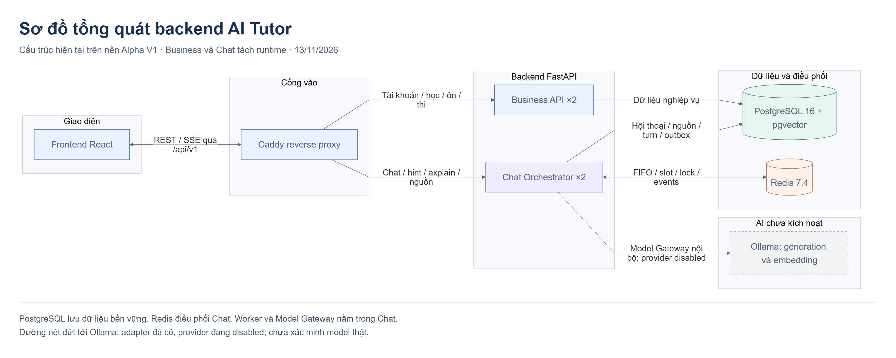

# Sơ đồ tổng quát backend AI Tutor

**Ngày cập nhật:** 13/11/2026.\
**Căn cứ:** code nhánh `feat/alpha-v1-backend`, commit `29708ae`; Compose Phase 1 và cấu hình routing Caddy. Đây là sơ đồ cấu trúc trong code, không phải kết quả kiểm tra dịch vụ đang chạy.

Code hiện tại đã bổ sung runtime Phase 1 trên nền tảng Alpha. Sơ đồ dưới đây mô tả cấu trúc hiện tại; Alpha ban đầu là một ứng dụng FastAPI chứa cả nghiệp vụ và Chat.

## 1. Sơ đồ để trình bày

- [Mở ảnh PNG](diagrams/backend-overview.png) để chèn vào slide.
- [Mở SVG](diagrams/backend-overview.svg) để phóng to mà vẫn rõ chữ.
- [Mã Mermaid](diagrams/backend-overview.mmd) để sửa sơ đồ.

## 2. Trách nhiệm từng thành phần

| Thành phần | Trách nhiệm |
|---|---|
| **Frontend React** | Hiển thị giao diện, gửi thao tác và nhận kết quả qua REST/SSE. Backend quyết định đáp án, điểm, deadline và lịch ôn. |
| **Caddy** | Bỏ prefix `/api`, chuyển request tới đúng nhóm backend, cân bằng tải theo `least_conn`, kiểm tra readiness và flush SSE. Cấu hình local mặc định dùng HTTP. |
| **Business API ×2** | Hai instance phục vụ tài khoản, consent, hồ sơ, học, câu trả lời, ôn thẻ, thi thử, tiến độ và dashboard. Không gọi model. |
| **Chat Orchestrator ×2** | Hai instance phục vụ hội thoại, lịch sử, hint/explain, citations và rating; mỗi instance có worker/pipeline/gateway nội bộ. Gateway không phải một deployment riêng. |
| **PostgreSQL** | Lưu dữ liệu bền vững: tài khoản, nội dung, đáp án, thẻ, bài thi, tiến độ, hội thoại, turn/outbox và metadata model call. Có pgvector để lưu/tìm vector khi đã lập index. |
| **Redis** | Điều phối FIFO, learner lock, giới hạn model slot, processing lease và event stream cho SSE. Không thay PostgreSQL làm nguồn dữ liệu bền vững. |
| **Ollama** | Đường kết nối generator/embedding đã có adapter. Provider đang được cấu hình `disabled`; đường nét đứt không biểu thị model thật đã hoạt động. |

Hai instance của mỗi ứng dụng được gom thành một ô cho dễ đọc. Không có lời gọi model trực tiếp từ frontend hoặc Business. Mỗi ứng dụng giữ các lớp API → service → repository; thuật toán học/ôn/thi ở module engine.

## 3. Hai luồng chính

### Luồng học và thi

1. Frontend gửi thao tác qua Caddy tới Business API.
2. Business kiểm tra token, consent, quyền sở hữu và điều kiện nghiệp vụ.
3. Backend chấm theo đáp án chuẩn; lưu đáp án, cập nhật mastery, tạo thẻ khi sai và ghi hoạt động trong transaction tương ứng.
4. PostgreSQL commit dữ liệu; API trả kết quả về giao diện.

### Luồng AI khi provider được bật

1. Frontend gửi yêu cầu chat tới Chat Orchestrator qua Caddy.
2. Chat kiểm tra quyền, consent, trạng thái thi và idempotency; ghi turn/outbox vào PostgreSQL.
3. Outbox được phát vào Redis; worker claim lượt qua FIFO, lock và giới hạn slot dùng chung.
4. Worker lấy nguồn bằng connection ngắn; gateway gọi model khi được phép, không giữ connection DB trong thời gian chờ model.
5. Worker kiểm tra lại điều kiện và fencing, lưu kết quả vào PostgreSQL rồi phát sự kiện để client nhận qua SSE. Client có thể nối lại bằng turn/event ID.

Khi provider đang `disabled`, yêu cầu sinh nội dung mới trả lỗi rõ ràng; các bước gọi model không thực thi. Đọc lịch sử và các nghiệp vụ học/thi vẫn có đường API riêng.

## 4. Ghi chú routing và môi trường

- Frontend dùng `/api/v1`; backend phục vụ `/v1`.
- Route chấp nhận suggestion thuộc Business và đứng trước rule Chat tổng quát.
- Sessions/messages/turns, passages, rating và hint/explain thuộc Chat; phần nghiệp vụ còn lại thuộc Business.
- Bản build frontend do Caddy phục vụ. Khi phát triển, Vite proxy tới Caddy; Vite không phải một backend nghiệp vụ.
- Redis/PostgreSQL/backend nằm trong mạng nội bộ của Compose; hình này không thể hiện cổng được mở ra Internet.
- Hai replica không tự chứng minh đã chịu được 30–50 người học. Hình không bao gồm kho biên soạn tài liệu đang mới ở trạng thái đề xuất.

## 5. Lời giải thích khoảng 45 giây

> Frontend gửi request qua Caddy. Caddy chia thành hai nhóm: Business xử lý tài khoản, học, ôn, thi và tiến độ; Chat xử lý hội thoại, nguồn và pipeline AI. Mỗi nhóm có hai instance theo cấu hình hiện tại. PostgreSQL giữ dữ liệu chính thức, còn Redis điều phối queue, khóa và slot dùng chung cho Chat. Lời gọi model chỉ đi qua gateway bên trong Chat. Hiện adapter Ollama đã có nhưng provider đang tắt, nên em chưa báo cáo AI thật đã hoạt động. Kiến trúc này đã tách runtime Business và Chat trên nền tảng Alpha ban đầu.

## 6. Nguồn đối chiếu

- [Docker Compose Phase 1](../../deploy/compose.phase1.yml).
- [Routing Caddy](../../deploy/Caddyfile).
- [Entrypoint Business](../../backend/app/main_business.py) và [Chat](../../backend/app/main_chat.py).
- [Worker Chat](../../backend/app/chat/worker.py), [admission Redis](../../backend/app/chat/admission.py).
- [Kiến trúc chi tiết](architecture.md) và [báo cáo backend để trình bày](../alpha-v1/backend-progress-presentation.md).
