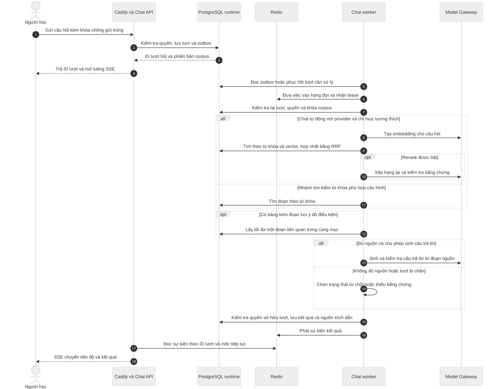

# Báo cáo tiến độ backend DocPrep

**Ngày 25/11/2026** · **Nhánh `feat/yhdp-corpus-rechunk`** · **Commit đối chiếu `c7ab812`**

Trong đợt vừa rồi, em bổ sung luồng đọc tài liệu Word gốc, chia lại học liệu, gắn ngữ cảnh, liên kết mục cha, từ khóa và câu hỏi nháp. Pipeline đã chạy trên **5 tài liệu gốc**, tạo **1.456 chunk** và lưu thử dưới dạng phiên bản mới. Bộ mới hiện **chờ phân loại và duyệt nội dung trong DB biên tập**. Phần tiếp theo là khôi phục cấu trúc hai tài liệu OCR, bổ sung và đánh giá tagger, sau đó so sánh release mới với release cũ trên luồng Chat thật.

## 1. Sơ đồ tổng quát

- **Business API** nhận yêu cầu về tài khoản, học tập, ôn tập và thi. PostgreSQL lưu trạng thái nghiệp vụ.
- **Chat API và worker** nhận câu hỏi, điều phối lượt xử lý qua Redis, truy xuất học liệu đã phát hành và lưu lại kết quả cùng nguồn trích dẫn. Cấu hình triển khai local mặc định tắt provider sinh nội dung.
- **Content Workspace** là nơi nhập, phân loại và duyệt học liệu. Người vận hành xuất một bản học liệu có phiên bản rồi nhập vào runtime qua Publisher CLI. Hai môi trường có DB riêng.

Các cổng và số instance trong sơ đồ là cấu hình Compose local. [Runtime Compose](../../deploy/compose.phase1.yml) · [Content Compose](../../deploy/compose.content.yml) · [Quy tắc định tuyến](../../deploy/Caddyfile)

## 2. Sơ đồ chi tiết và cách backend hoạt động

### 2.1. Luồng học tập và Chat

Với luồng học tập thông thường, giao diện gọi REST qua Caddy. Business API kiểm tra người học, thực hiện nghiệp vụ và cập nhật trạng thái học, ôn hoặc thi trong DB. Khóa idempotency trên các thao tác ghi hỗ trợ trường hợp client phải gửi lại.

1. **Nhận câu hỏi.** Chat API kiểm tra quyền, chốt phiên bản học liệu cho lượt hỏi và lưu `ai_turn` cùng `ai_outbox` vào PostgreSQL. ID lượt hỏi giúp client theo dõi và kết nối lại khi luồng SSE bị ngắt.
2. **Điều phối xử lý.** Worker đọc việc từ outbox và dùng Redis để xếp hàng, cấp lease và phát sự kiện. PostgreSQL giữ trạng thái lượt để có thể đối chiếu và phục hồi.
3. **Tìm nguồn.** Với lượt Chat phù hợp, provider thật và chỉ mục tương thích, worker tìm theo từ khóa và vector, hợp nhất thứ hạng bằng RRF, rồi dùng reranker nếu đã bật. Reranker đưa các đoạn liên quan lên đầu và giúp chặn câu hỏi thiếu bằng chứng. Bảng có thể lấy kèm tối đa một đoạn lưu ý cùng mục nếu thỏa điều kiện. Đoạn bổ sung giữ ID trích dẫn riêng.
4. **Trả kết quả.** Khi đủ bằng chứng, worker chuyển các đoạn nguồn cho bước sinh và kiểm tra câu trả lời. Nếu thiếu bằng chứng, Chat trả về trạng thái tương ứng. Worker lưu kết quả, phiên bản học liệu và trích dẫn, sau đó phát sự kiện để giao diện cập nhật.

Sơ đồ mô tả luồng Chat chính. Việc có chạy nhánh hybrid hay không phụ thuộc loại lượt, provider và chỉ mục của release. Lỗi chỉ mục ở nhánh hybrid cần được báo riêng khi đánh giá. [Chat API](../../backend/app/api/turns.py) · [Chat worker](../../backend/app/chat/worker.py) · [Hybrid retrieval](../../backend/app/repo/embeddings.py)

### 2.2. Luồng chuẩn bị học liệu cho Chat

1. **Đọc nguồn.** Hệ thống đọc đoạn văn, tiêu đề, bảng và ảnh từ Word. Với file scan, OCR tiếng Việt trích chữ từ ảnh trang và lưu thông tin để đối chiếu lại nguồn.
2. **Chia và gắn thông tin.** Ba file Word có văn bản được chia theo đề mục. Bảng dài được chia theo nhóm hàng và lặp tiêu đề cột. Sau khi chia, pipeline lưu vị trí trong tài liệu, mục cha, từ khóa và câu hỏi nháp có trích đoạn làm bằng chứng.
3. **Nhập DB biên tập.** Mỗi lần nhập tạo revision. Nhập lại cùng dữ liệu dùng lại revision đã có. Người duyệt có thể kiểm tra tài liệu gốc, nhãn và nội dung của từng chunk.
4. **Tạo release.** Khi nhãn, nội dung và bảng ánh xạ được xác nhận, người vận hành xuất release. Lúc nhập vào runtime, mỗi chunk đủ điều kiện được chuyển thành một `passage`, có phiên bản và thông tin trích dẫn.
5. **Chuẩn bị cho Chat.** Lập chỉ mục embedding theo release và kích hoạt release trên môi trường thử. Kết quả của bản rechunk hiện dừng ở bước nhập thử vào DB biên tập. Sơ đồ đánh dấu các phần đang chuẩn bị làm bằng đường nét đứt.

Điểm cần nói rõ khi báo cáo: **lưu được chunk vào DB** xác nhận khả năng nhập và quản lý phiên bản. **Chat dùng được chunk** đòi hỏi chunk đủ điều kiện phát hành, release được kích hoạt và chỉ mục phù hợp với cấu hình truy xuất. [Lệnh rechunk](../../backend/app/content/cli.py) · [Quy trình phát hành](../../backend/app/content/publication.py)

## 3. Sơ đồ ERD

ERD được chia thành hai hình theo hai cơ sở dữ liệu. Các hình tập trung vào bảng cốt lõi liên quan đến báo cáo.

### 3.1. DB biên tập

- `source_document_revision` lưu mỗi phiên bản của tài liệu. Một phiên bản có nhiều `document_chunk` và `source_asset`.
- `document_chunk.location` là JSON chứa đường dẫn đề mục, vị trí trang và thông tin bổ sung. Trong bản hiện tại, `parent_id` là mã mục cha lưu trong metadata. Nó không phải khóa ngoại đến một bảng mục cha riêng.
- `chunk_tag_set` lưu bộ nhãn theo một phiên bản danh mục. Các nhãn vấn đề và miền được lưu ở hai bảng con. `chunk_state` giữ trạng thái, bộ nhãn được đề xuất và bộ nhãn đã xác nhận. Quyết định duyệt nằm ở `chunk_review_decision`.

[Schema DB biên tập](../../backend/content_migrations/0001.sql)

### 3.2. DB runtime

- `ai_turn` và `ai_outbox` lưu công việc Chat. `chat_session` và `chat_message` lưu phiên hội thoại, câu trả lời và trích dẫn.
- `document` và `passage` lưu tài liệu phục vụ truy xuất. `passage_embedding` gắn vector với passage và phiên bản chỉ mục. `corpus_activation` chọn release theo kênh.
- `corpus_release_member` giữ mã chunk, mã revision và ảnh chụp thông tin phân loại tại thời điểm phát hành. Hai mã nguồn này tham chiếu logic đến DB biên tập. Trích dẫn của tin nhắn lưu trong JSON cùng phiên bản corpus.

[Schema lượt AI](../../backend/migrations/versions/0013_phase1_turns.py) · [Schema embedding](../../backend/migrations/versions/0015_embeddings.py) · [Schema release](../../backend/migrations/versions/0018_corpus_releases.py)

## 4. Những việc đã hoàn thành

| Nội dung | Kết quả đã kiểm tra |
|---|---|
| Chạy pipeline trên tài liệu gốc | 3 Word có văn bản tạo **525 chunk**. 2 Word dạng scan qua OCR tạo **931 chunk**. Tổng **1.456 chunk**. |
| Gắn ngữ cảnh, mục cha và từ khóa | Đã lưu metadata theo từng chunk. **1.429 chunk** có câu hỏi nháp kèm trích đoạn đối chiếu. **27 chunk** cần bổ sung hoặc rà câu hỏi. |
| Phiên bản và lưu thử | DB PostgreSQL riêng chứa **477 chunk cũ** và **1.456 chunk mới**. Nhập lại tái sử dụng cả 5 phiên bản mới. Đã kiểm tra ca truy xuất thêm đoạn cùng mục và giữ trích dẫn riêng. |
| Đánh giá tìm kiếm ban đầu | Trong 80 câu có thể đối chiếu trên 3 tài liệu Word, số câu tìm đúng trong top 5 là **45** với bộ cũ có header, **54** với bộ mới có header, **55** khi thêm từ khóa và câu hỏi. Đây là phép đo từ vựng offline. |

[Báo cáo chạy và cách tái lập](rechunk-review.md) · [Ví dụ trước và sau ở Phụ lục 9](qd2760-chunking-pilot.md)

## 5. Việc chuẩn bị làm tiếp theo

### Điều kiện đầu vào · Khôi phục cấu trúc hai tài liệu OCR

Bản hiện tại dùng nhãn **Ảnh trang N** làm đường dẫn mục cho tài liệu scan. Nếu một tiểu mục kéo dài qua hai ảnh, các chunk bị tách thành hai mục cha. Hướng chuẩn bị là **ảnh scan → văn bản có cấu trúc → phát hiện chương, mục, tiểu mục và bảng → chia chunk**. Thứ tự ảnh gốc lưu riêng để trích dẫn. Ví dụ, một mục bắt đầu ở ảnh 12 và tiếp tục sang ảnh 13 vẫn có chung parent nếu cùng heading.

Đầu ra cần duyệt là một bản văn bản định dạng được cho mỗi nguồn và mẫu đối chiếu có đủ ba trường hợp: mục qua nhiều trang, một trang có nhiều tiểu mục, bảng có hàng hoặc tiêu đề cột kéo sang trang sau. Mục không xác định chắc chắn được đưa vào danh sách rà tay.

### 1. Bổ sung tự động đề xuất nhãn chuyên môn

- Đối chiếu chunk mới với dữ liệu cũ. Chỉ kế thừa nhãn khi có căn cứ khớp về nguồn, đề mục và nội dung. Ca tách hoặc gộp làm thay đổi ý cần đề xuất lại.
- Dùng model mạnh hơn để xử lý phần còn lại, ưu tiên OCR đã khôi phục bố cục. Xác nhận hạn mức miễn phí với đội dự án trước khi chạy. Giữ model local làm dự phòng và lưu model, phiên bản danh mục, nguồn nhãn và lý do đề xuất.
- Lưu kết quả dưới dạng **nhãn đề xuất**. Trường hợp thiếu căn cứ giữ trạng thái chờ rà. Đầu ra là số chunk kế thừa được, số chunk model đề xuất và số chunk cần người duyệt.

### 2. Đo chất lượng tagger trước khi chạy diện rộng

- Lấy mẫu chunk đã được reviewer duyệt làm nhãn đối chiếu, gồm Word có văn bản và OCR. Khóa bộ mẫu trước khi đo và phân biệt nhãn kế thừa với dự đoán mới để tránh tính lại nhãn cũ như kết quả của model.
- Đo **Cohen’s kappa** cho vấn đề chính và Bloom. Với miền năng lực có nhiều nhãn, báo cáo theo từng miền trên mẫu đủ dữ liệu, kèm cỡ mẫu, tỷ lệ đồng ý và các ca lệch nhiều. Đo riêng kết quả trên OCR.
- Xin lead chốt tiêu chí chấp nhận và cách xử lý nhãn hiếm trước khi áp dụng trên toàn bộ corpus. Đầu ra là bảng số liệu, danh sách lỗi điển hình và quyết định có mở rộng hay cần chỉnh tagger.

### 3. So sánh trên Chat pipeline thật

- Tạo release thử từ các chunk đủ điều kiện. Kiểm tra mapping, chỉ mục embedding và phiên bản release mà mỗi lượt Chat sử dụng.
- Chạy cùng bộ câu hỏi, cùng provider và cấu hình truy xuất trên release cũ và mới. Ghi lại kết quả trước và sau rerank để biết phần nào cải thiện. Chấm khả năng tìm đúng nguồn trong top 5, độ đúng của trích dẫn và cách xử lý câu thiếu bằng chứng. Theo dõi thêm độ trễ và số lượt gọi model.
- Bổ sung câu hỏi có đáp án trong hai tài liệu OCR để đo phạm vi mới. Đầu ra là kết quả theo từng release và nhóm câu hỏi, dùng để quyết định bản mới đã sẵn sàng hay còn cần rà.

## 6. Kịch bản nói ngắn

> Em tách backend thành phần phục vụ người học và phần biên tập học liệu. Người học gọi Business API hoặc Chat API qua Caddy. Học liệu đi từ DB biên tập sang Chat qua bước duyệt và phát hành, nên khi nói đã nhập DB thì mới xác nhận bộ mới đã được lưu.
>
> Đợt này em chạy chia lại 5 tài liệu gốc và tạo 1.456 chunk. Em đã bổ sung ngữ cảnh, liên kết mục cha, từ khóa và câu hỏi nháp. Mẫu Phụ lục 9 cho thấy cách một bảng lấy kèm đoạn lưu ý và vẫn giữ trích dẫn của từng đoạn.
>
> Phần em chuẩn bị làm tiếp là dựng lại heading và bảng cho tài liệu OCR, rồi mới tự đề xuất nhãn chuyên môn. Em sẽ dùng mẫu đã duyệt để đo chất lượng tagger. Sau đó em đưa các chunk đủ điều kiện vào release thử và so sánh trực tiếp trên Chat có hybrid retrieval và reranking.
