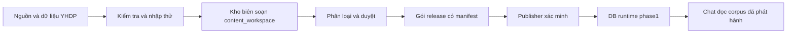
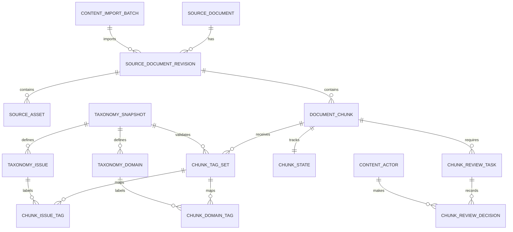
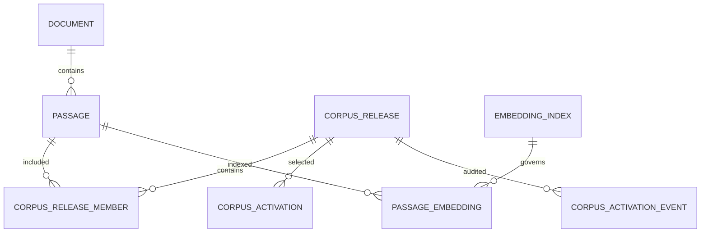

# Đề xuất thiết kế database tài liệu YHDP cho AI Tutor Phase 1

> **Cập nhật 16/11/2026:** đã triển khai và kiểm thử luồng local/dev theo lựa chọn người phụ trách: DB riêng, giao diện reviewer, tài khoản content riêng, một reviewer xác nhận nhãn/nội dung bằng hai quyết định, SQLite là nguồn chuẩn và chunk chưa xác nhận không được phát hành. Xem [thiết kế và runbook](content-workspace.md), [kết quả kiểm chứng](content-workspace-verification.md). Các lựa chọn được xác nhận trong phiên này không thay xác nhận chuyên môn của Lead về mapping, nguồn và chuẩn ký; nội dung bên dưới là bản đề xuất ban đầu ngày 12/11, không mô tả trạng thái triển khai hiện tại.

**Ngày chuẩn bị:** 12/11/2026.\
**Buổi trao đổi dự kiến:** 13/11/2026.\
**Trạng thái:** bản đề xuất để trình bày và chốt với Lead; chưa phải thiết kế đã được phê duyệt.\
**Phạm vi lần này:** thiết kế dữ liệu, luồng nhập, phân loại, duyệt và phát hành tài liệu. Chưa chạy migration hoặc nhập dữ liệu vào DB đang sử dụng.

## 1. Nội dung em đề xuất và cần Lead chốt

Em đề xuất xây kho tài liệu có quản lý phiên bản, giữ nguyên cấu trúc nguồn của YHDP và chia chunk thành hai nhóm: **đã phân loại rõ ràng** và **chưa phân loại hoặc chưa được xác nhận**. Mỗi chunk vẫn truy ngược được tài liệu, mục/trang, nhãn, lý do cần kiểm tra và người xác nhận.

Về lưu trữ, phương án ưu tiên là **kho biên soạn riêng**, sau đó phát hành nội dung đã duyệt sang PostgreSQL của ứng dụng học tập. Ứng dụng tiếp tục dùng các bảng `document`, `passage`, `passage_embedding` hiện có. Content team làm việc trong kho biên soạn và không được đọc dữ liệu người học.

Những quyết định quan trọng cần chốt trong buổi họp:

1. “Phân loại rõ ràng” có bắt buộc người duyệt xác nhận hay cho phép tự động chấp nhận theo chính sách?
2. Giữ những trường nào trong form YHDP: vấn đề chính/phụ, miền năng lực, Bloom, loại nội dung, đối tượng?
3. Tách kho biên soạn thành database riêng ngay, hay làm bản local tạm thời trong cùng database bằng quyền riêng?
4. Chunk chưa phân loại có được dùng cho tìm kiếm/AI không? Em đề xuất giữ trong kho biên soạn đến khi đủ điều kiện phát hành.
5. Ai duyệt phân loại, ai duyệt nội dung, ai phát hành; cần bao nhiêu vòng duyệt?
6. Bộ taxonomy/mapping, tài liệu gốc, quyền sử dụng và cơ chế ký gói phát hành do ai cung cấp?

**Kết quả cần có sau cuộc họp:** một bản ghi quyết định tại mục 18, có người chịu trách nhiệm và các điều kiện còn chờ. Những mục chưa quyết định tiếp tục giữ trạng thái đề xuất.

## 2. Căn cứ và giới hạn của bản đề xuất

| Căn cứ | Cách sử dụng |
|---|---|
| Yêu cầu được chuyển từ anh Khanh | Quản lý hai nhóm chunk: đã phân loại rõ và chưa phân loại được. Ý nghĩa chi tiết của “rõ ràng” cần xác nhận. |
| `data.zip` tại `D:\InternAIRC\AI_TuTor\data.zip` | Kiểm tra trực tiếp cấu trúc file và SQLite ở chế độ chỉ đọc. Không chạy code hoặc nhập dữ liệu từ ZIP. |
| Nhánh nguồn `origin/sync/yhdp-frontend-api-v1`, commit `e9e3af7660e22c7299ee274c8c02e8c1e92626c6` | Đọc `backend/yhdp/store/schema.sql`, `ingest/chunk.py`, `ingest/tag.py`, `ingest/load_db.py`. Đây là remote-tracking ref đang có trong checkout; không có lượt fetch mới riêng cho tài liệu này. |
| Repo hiện tại, nhánh `feat/alpha-v1-backend`, commit `29708ae` | Đọc migrations 0001–0016, retrieval/index, cấp quyền và content tools. Các README local đang sửa không phải một release mới. |
| Word `AIRC_Kien_truc_backend_Alpha_V1_den_Phase_1.docx` | Đối chiếu nội dung về content team riêng, corpus có phiên bản/chữ ký, quyền đọc nội dung và một chủ thể migration. |
| [Kế hoạch tích hợp hiện có](integration-plan.md), [source map](yhdp-source-map.md) | Giữ các ranh giới Business/Chat, gateway, queue và các điều kiện nghiệm thu còn mở. |

Word có dẫn PDF N1; PDF này chưa được đối chiếu trong lần chuẩn bị. “Form anh Khanh” ở đây được suy ra từ code và dữ liệu YHDP, chưa có biểu mẫu riêng được anh xác nhận. Các thông số model, ngưỡng confidence, chữ ký, reviewer và nơi triển khai dưới đây không được coi là đã chốt.

## 3. Hiện trạng đã kiểm tra

### 3.1. Dữ liệu trong ZIP

| Nội dung | Kết quả |
|---|---:|
| Nguồn khai báo trong `sources.yaml` | 5 |
| Tài liệu đã có chunk trong SQLite | 3 |
| Chunk của `qd2760` | 180 |
| Chunk của `qd5642` | 187 |
| Chunk của `qd5904` | 110 |
| Tổng chunk | 477 |
| Nhãn tự động khớp đúng hash nội dung hiện tại, `review_status=auto` | 171 |
| Nhãn tự động khớp đúng hash nội dung hiện tại, `review_status=review` | 306 |
| Nhãn có `source=human` | 0 |
| Vector trong SQLite, model ghi là `bge-m3` | 477 |

SQLite có 479 bản ghi `chunk_tags`, nhưng chỉ 477 nhãn tự động khớp chunk/hash hiện tại. Không lấy tổng lịch sử nhãn làm số chunk hiện hành. Hai nguồn scan `dtch`, `ngodoc` có ảnh trang/manifest trong ZIP nhưng chưa có chunk tương ứng trong DB được kiểm tra.

Các lý do trong 306 hàng chờ tag gồm bất đồng vấn đề, bất đồng miền, bất đồng Bloom, confidence thấp, hình chưa mô tả và bảng bị làm phẳng. Một chunk có thể có nhiều lý do; không cộng các lý do để tính số chunk.

**171 chunk `auto` chưa phải 171 chunk được chuyên gia duyệt.** Không có bằng chứng nhãn human trong snapshot này. Tên trạng thái `validated` của câu hỏi YHDP cũng không tự thay thế quy trình duyệt câu hỏi hiện tại của Phase 1.

### 3.2. Cách YHDP đang tổ chức tài liệu

| Bảng nguồn | Vai trò |
|---|---|
| `documents` | Mã, tên, đơn vị ban hành, năm, loại tài liệu và cách trích dẫn. |
| `chunks` | Đoạn nội dung; thứ tự; loại text/table/figure/box/formula; đường dẫn mục/trang; hash; cờ kiểm tra. |
| `chunk_tags` | Nhãn tự động hoặc nhãn người duyệt, gắn với `chunk_id + content_hash`. |
| `review_items` | Công việc cần kiểm tra, lý do và trạng thái xử lý. |
| `chunk_vectors` | Vector gắn chunk/model và hash nội dung tìm kiếm. |

Tagger YHDP phân loại hai lượt, so sánh vấn đề chính, miền và Bloom; confidence thấp hoặc cờ chất lượng làm chunk đi vào hàng chờ. Đây là cơ chế nguồn để tham khảo, chưa phải chính sách duyệt đã được Lead phê duyệt cho DB mới.

### 3.3. Backend Phase 1 đã có gì

- `document`, `passage`: dữ liệu nguồn mà Chat/citations đang sử dụng.
- `passage_embedding`, `embedding_index`: vector PostgreSQL/pgvector với model revision, corpus version và hash.
- `core_issue`, `core_issue_group`, `exam_competency_component`, `competency_node`: danh mục học/thi hiện có.
- `question`, `content_item`, `review_decision`: version và duyệt nội dung học/câu hỏi; không phải luồng duyệt chunk tài liệu.
- `app/content_tools/model.py`, `chunk.py`: đã có hợp đồng parser/chunker dạng pure; chưa phải một importer tài liệu hoàn chỉnh.

Điểm còn thiếu là quản lý file/phiên bản tài liệu, nhiều nhãn trên mỗi chunk, trạng thái phân loại được xác nhận, workflow duyệt chunk và gói phát hành. `passage.competency_code` chỉ là một trường, không chứa đủ form phân loại YHDP.

## 4. Tách các khái niệm trước khi tạo bảng

| Khái niệm | Nghĩa trong thiết kế |
|---|---|
| Tài liệu | Một đầu tài liệu có định danh ổn định, ví dụ `qd2760`. |
| Phiên bản xử lý tài liệu | Một snapshot đầu vào và kết quả xử lý, gắn phiên bản nguồn/parser/chunker. Không đồng nhất với năm ban hành. |
| Chunk | Một đoạn nội dung và vị trí nguồn thuộc đúng một phiên bản xử lý. |
| Phân loại | Gắn chunk vào taxonomy: vấn đề, miền, Bloom, loại nội dung, đối tượng. |
| Duyệt nội dung | Xác nhận độ đúng, đầy đủ, nguồn, chất lượng OCR/bảng/hình và quyền sử dụng theo chính sách. |
| Phát hành | Đóng gói tập chunk/nhãn đã đủ điều kiện để ứng dụng được sử dụng. |
| Embedding | Dữ liệu dẫn xuất phục vụ tìm kiếm; không phải bằng chứng nội dung đã duyệt. |

Ví dụ: đoạn nói rõ về chẩn đoán có thể được phân loại rõ nhưng vẫn đang chờ kiểm tra một con số OCR. Nó thuộc nhóm “đã phân loại” nhưng chưa được phát hành. Ngược lại, đoạn đọc được và đúng nguồn vẫn có thể chưa xác định được vấn đề chính.

## 5. Chính sách hai nhóm chunk

### 5.1. Trạng thái hiển thị

| Mã đề xuất | Tên hiển thị | Điều kiện đề xuất |
|---|---|---|
| `classified` | Đã phân loại rõ ràng | Có một bộ nhãn được xác nhận, khớp đúng phiên bản chunk và taxonomy; các trường bắt buộc hợp lệ. |
| `unclassified` | Chưa phân loại hoặc chưa xác nhận | Chưa có nhãn, nhãn mới là đề xuất, đang tranh luận, mapping chưa chốt hoặc phiên bản nội dung đã thay đổi. |

Đề xuất ban đầu: xác nhận của người có quyền là điều kiện chuyển `classified`. Nếu Lead chọn auto-accept, cần một policy có version, điều kiện rõ và audit riêng; không lấy `source=auto` làm điều kiện đủ.

Các lý do chi tiết lưu riêng: `not_tagged`, `awaiting_confirmation`, `low_confidence`, `label_disagreement`, `taxonomy_unmapped`, `source_changed`. Cờ OCR/bảng/hình được giữ như vấn đề chất lượng; chỉ chặn phân loại khi nó khiến nhãn không xác định được, và vẫn có thể chặn phát hành độc lập.

### 5.2. Quy tắc nhập snapshot ban đầu

- 171 nhãn `auto` được giữ là đề xuất tự động có sẵn, mặc định `unclassified/awaiting_confirmation` theo chính sách đề xuất.
- 306 nhãn `review` được giữ cùng lý do; mặc định `unclassified` và tạo hàng chờ tương ứng.
- Hai bản ghi nhãn không khớp chunk/hash hiện tại được giữ trong artifact nhập gốc kèm báo cáo đối soát. Chỉ chuyển thành nhãn chuẩn hóa của revision lịch sử khi có đủ nội dung tương ứng; không gắn chúng vào chunk hiện tại hoặc chế tạo revision cũ.
- Không xóa hoặc ép một nhãn ngẫu nhiên cho các chunk chưa rõ.
- Bộ đếm 171/306 là trạng thái nguồn; bộ đếm `classified/unclassified` của DB mới tính theo chính sách đã duyệt. Nếu giữ chính sách người xác nhận và chưa duyệt gì, số `classified` ban đầu là 0.

### 5.3. Điều kiện cho phép AI sử dụng

Đề xuất chỉ đưa vào corpus phục vụ người học khi đồng thời có:

1. Phân loại hợp lệ, đã xác nhận theo policy.
2. Duyệt nội dung/nguồn theo policy; các lỗi bắt buộc xử lý đã đóng.
3. Nguồn được phép sử dụng và có hiệu lực theo quyết định chuyên môn.
4. Thuộc một release được kiểm tra và đang được kích hoạt.
5. Với truy vấn vector: index khớp release, model revision, dimension và hash.

“Đã phân loại”, “đã duyệt” và “được AI dùng” là ba trạng thái cần hiển thị độc lập.

## 6. Vị trí lưu trữ và phương án ưu tiên

### 6.1. Các lựa chọn để Lead xem xét

| Phương án | Ưu điểm | Chi phí/rủi ro | Đề xuất |
|---|---|---|---|
| Thêm bảng vào `phase1.public` hiện tại | Ít thay đổi kết nối và migration | Cần siết quyền kỹ; khó bảo đảm content team không chạm dữ liệu learner nếu tiếp tục dùng quyền rộng | Chỉ cân nhắc cho pilot local có kiểm soát; không tự triển khai như thiết kế cuối. |
| Kho biên soạn ở DB logic riêng, runtime giữ DB hiện tại | Tách quyền và vòng đời biên soạn; ít tác động học/thi; tương thích hướng gói phát hành | Có bước publish và đối soát; không có FK xuyên database | **Phương án ưu tiên để chốt.** Local có thể dùng cùng PostgreSQL instance. |
| Kho biên soạn và hạ tầng content team tách máy/cluster | Ranh giới vận hành rõ hơn, phù hợp hướng hạ tầng content team riêng | Cần môi trường, backup và cơ chế chuyển gói | Đích triển khai theo Word; cần đầu vào vận hành. |

`content_workspace` là tên DB logic **đề xuất**, không phải DB đã tồn tại. Dùng hai database cùng instance ở local chưa chứng minh đã đạt yêu cầu tách hạ tầng khi vận hành thật.

### 6.2. Luồng tổng thể

Kho biên soạn là nguồn chính thức của dữ liệu đang soạn/duyệt. `document/passage` trong runtime là bản chiếu được tạo khi publish, không phải một bản sao chỉnh sửa độc lập. Không đồng bộ hai chiều bằng cách sửa cả hai nơi.

Content team không kết nối tới DB learner. Publisher nhận gói nội dung; chỉ được ghi các bảng phát hành và nguồn cần thiết. Mọi model call nếu bổ sung phân loại tự động vẫn phải qua gateway/admission đã được duyệt; chưa triển khai một tagger gọi Ollama trực tiếp từ script nhập.

## 7. Sơ đồ quan hệ đề xuất

### 7.1. Kho biên soạn

Sơ đồ giản lược không vẽ các FK phụ như actor nhận việc, tag set được quyết định và các con trỏ trong `chunk_state`; các ràng buộc đó được mô tả ở mục 8–9.

### 7.2. DB runtime

Không có FK xuyên từ runtime sang kho biên soạn. Liên kết dùng định danh nguồn, version, hash và manifest đã xác minh. `corpus_release_member` giữ snapshot cần thiết để runtime không phải gọi DB biên soạn khi trả lời người học.

## 8. Chi tiết các bảng trong kho biên soạn

Tên bảng/cột bên dưới là đề xuất để chốt thiết kế. Bản đầy đủ có 15 bảng kho biên soạn và 4 bảng release ở runtime; số lượng này bao gồm taxonomy, file, lịch sử và audit, không chỉ hai trạng thái chunk. Có thể triển khai theo các mốc ở mục 14, nhưng chưa cho phát hành khi thiếu các ràng buộc duyệt và quyền bắt buộc.

Kiểu `uuid` dùng cho định danh nội bộ; mã nguồn YHDP giữ bằng `text`. Mốc thời gian dùng `timestamptz`; hiển thị ngày theo `Asia/Ho_Chi_Minh`. Không lưu nội dung/file chưa có bằng chuỗi rỗng để giả đầy đủ.

### 8.1. Nhóm nhập và nguồn

| Bảng | Trường chính đề xuất | Mục đích và ràng buộc |
|---|---|---|
| `content_actor` | `id uuid PK`, `subject_ref text UNIQUE`, `actor_kind`, `display_name`, `active`, `created_at` | Danh tính người biên soạn/duyệt hoặc tiến trình hệ thống. Không FK tới learner; không sao chép tài khoản/mật khẩu từ ZIP. Cơ chế đăng nhập content team chờ quyết định riêng. Quyền editor/reviewer/publisher được kiểm tra theo hệ thống cấp quyền được chọn. |
| `content_import_batch` | `id uuid PK`, `source_namespace`, `archive_sha256`, `importer_version`, `mapping_version`, `status`, `counts jsonb`, `error_summary jsonb`, `created_by`, `created_at`, `finished_at` | Một lần nhập có thể chứa nhiều tài liệu. Trạng thái `running/completed/failed`. Khóa chống nhập lặp từ namespace + SHA-256 gói + importer/mapping version; quy trình resume dưới khóa batch cho phép thử lại phần lỗi. |
| `source_document` | `id uuid PK`, `source_namespace`, `external_doc_id`, `title`, `issuer nullable`, `publication_year nullable`, `source_kind`, `citation_mode`, `created_at` | Định danh đầu tài liệu. `UNIQUE(source_namespace, external_doc_id)`. `source_kind` giữ primary/secondary/textbook; không dùng nó thay trạng thái duyệt. Metadata không biết giữ null. |
| `source_document_revision` | `id uuid PK`, `document_id FK`, `revision_no`, `batch_id FK`, `source_version nullable`, `artifact_sha256`, `parser_version`, `chunker_version`, `tokenizer_version nullable`, `source_availability`, `created_at` | Snapshot bất biến của một lần xử lý. `UNIQUE(document_id, revision_no)`. Đổi nội dung/vị trí/parser/chunker có ảnh hưởng đầu ra tạo revision mới. `source_availability=original_available/derived_only/incomplete` thể hiện có hay thiếu file gốc. |
| `source_asset` | `id uuid PK`, `document_revision_id FK`, `asset_key`, `role`, `storage_key`, `mime_type`, `size_bytes`, `sha256` | File gốc, parsed JSON, chunks JSONL, ảnh trang/hình và manifest. DB giữ metadata; file đặt trong storage được quản lý. `UNIQUE(document_revision_id, asset_key)`, kích thước không âm. Không lưu đường dẫn tùy ý từ ZIP thành đường dẫn phục vụ web. |

Không giả định file DOCX gốc đã có trong ZIP: registry có thể trỏ tới file gốc nhưng các artifact hiện tại chủ yếu là dữ liệu đã xử lý. Thiếu gốc được báo riêng và xử lý theo policy nguồn; không tự chế tạo `source_sha256` cho file chưa có.

### 8.2. Bảng chunk

`document_chunk` lưu nội dung chuẩn để phân loại và duyệt, chưa phải nguồn tự động được AI đọc.

| Trường | Kiểu đề xuất | Ý nghĩa |
|---|---|---|
| `id` | `uuid PK` | Định danh nội bộ của chunk trong một revision. |
| `document_revision_id` | `uuid FK NOT NULL` | Revision sở hữu chunk. |
| `source_chunk_id` | `text NOT NULL` | Giữ mã YHDP như `qd2760#I#c01`. Không giả định mã này duy nhất qua nhiều revision. |
| `seq` | `integer NOT NULL` | Thứ tự đọc trong revision; không âm. |
| `kind` | `text NOT NULL` | `text/table/figure/box/formula`. Đây là loại cấu trúc, độc lập với hai nhóm phân loại. |
| `text` | `text NOT NULL` | Nội dung gốc của chunk, giữ Unicode. |
| `search_text` | `text NOT NULL` | Snapshot title + section path + text dùng khi chuẩn bị tìm kiếm; thuật toán tạo phải có version. |
| `location` | `jsonb NOT NULL` | `section_path`, `anchor`, `printed_pages`, `image_indices`. Giữ số trang in dạng text vì có thể có trang La Mã. |
| `tokens` | `integer NULL` | Số token theo tokenizer xác định; không coi số cũ đúng với mọi model. |
| `content_sha256` | `text NOT NULL` | Hash chuẩn mới theo thuật toán chuẩn hóa có version. |
| `source_content_hash` | `text NULL` | Hash legacy YHDP và thuật toán đi kèm, để đối soát nhãn nguồn. |
| `quality_flags` | `jsonb NOT NULL` | Danh sách cờ OCR/bảng/hình; phải đúng schema. |
| `references` | `jsonb NOT NULL` | Các anchor liên quan; không tự ghép thành đường dẫn web. |

Ràng buộc: `UNIQUE(document_revision_id, source_chunk_id)` và `UNIQUE(document_revision_id, seq)`. Không đặt unique toàn cục lên hash vì các tài liệu có thể có đoạn giống nhau và vẫn phải giữ xuất xứ riêng.

Các nội dung/vị trí đã được duyệt không sửa tại chỗ. Sửa nội dung hoặc cách chia đoạn tạo revision/chunk mới; nhãn cũ giữ lịch sử và không tự trở thành nhãn đã xác nhận cho chunk mới.

### 8.3. Taxonomy và bộ nhãn

| Bảng | Trường chính đề xuất | Mục đích và ràng buộc |
|---|---|---|
| `taxonomy_snapshot` | `id uuid PK`, `version text UNIQUE`, `source_ref`, `mapping_version`, `payload_sha256`, `schema jsonb`, `approval_status` | Chốt danh mục, mã và schema nhãn tại thời điểm gắn nhãn. Bản dùng phát hành phải có mapping được duyệt. Không đọc trực tiếp danh mục learner từ DB runtime bằng tài khoản content team. |
| `taxonomy_issue` | `snapshot_id FK`, `issue_id integer`, `group_code`, `name`, `runtime_issue_id nullable`, `runtime_competency_code nullable` | PK `(snapshot_id, issue_id)`. Snapshot cho biết mỗi vấn đề nguồn sẽ map tới dữ liệu đích nào; mapping chưa rõ giữ null và chặn phát hành theo học phần. |
| `taxonomy_domain` | `snapshot_id FK`, `domain_code text`, `name`, `runtime_component_id nullable` | PK `(snapshot_id, domain_code)`. Mã YHDP như `2.3` cần mapping, không ép kiểu để suy ra PK integer của runtime. |
| `chunk_tag_set` | `id uuid PK`, `chunk_id FK`, `taxonomy_snapshot_id FK`, `source auto/human`, `provenance jsonb`, `bloom_ceiling`, `bloom_confidence nullable`, `content_type`, `population text[]`, `rationale`, `original_payload jsonb`, `created_by nullable`, `created_at` | Một đề xuất nhãn bất biến. `provenance` ghi nguồn nhập, model/prompt nếu có bằng chứng; dữ liệu thiếu giữ null. Lưu payload gốc để đối soát nhưng không dùng payload thay kiểm tra nhãn chuẩn hóa. |
| `chunk_issue_tag` | `tag_set_id FK`, `taxonomy_snapshot_id`, `issue_id`, `is_primary`, `confidence nullable` | PK `(tag_set_id, issue_id)`. FK có version tới taxonomy; partial unique bảo đảm tối đa một primary. Khi xác nhận phải có đúng một vấn đề chính và tối đa hai vấn đề phụ theo form nguồn đề xuất. |
| `chunk_domain_tag` | `tag_set_id FK`, `taxonomy_snapshot_id`, `domain_code`, `confidence nullable` | PK `(tag_set_id, domain_code)`. Đề xuất form giữ 1–2 miền; cần Lead xác nhận có mở rộng không. |

FK composite phải bảo đảm `taxonomy_snapshot_id` ở từng tag khớp bộ nhãn sở hữu nó; không chỉ kiểm tra từng ID tồn tại. Confidence trong `[0,1]` khi có; đánh giá thủ công không bắt buộc giả lập confidence bằng 1.

`de_muc` được suy ra từ các vấn đề trong đúng snapshot; không có một bản copy riêng có thể lệch nhãn. `mcq_eligible` được suy ra từ Bloom và policy có version; đây là gợi ý đủ điều kiện tạo câu hỏi, không phải phê duyệt câu hỏi.

**Bloom cần mapping riêng:** YHDP lưu trần Bloom bằng nhãn như Nhớ/Hiểu/Áp dụng/Phân tích/Đánh giá; `question.bloom_level` hiện chỉ nhận 1–3. Không copy số thứ tự hoặc nhãn giữa hai hệ khi chưa duyệt ý nghĩa tương ứng.

### 8.4. Duyệt và trạng thái hiện hành

| Bảng | Trường chính đề xuất | Vai trò |
|---|---|---|
| `chunk_review_task` | `id uuid PK`, `chunk_id FK`, `tag_set_id nullable`, `purpose`, `status`, `reasons jsonb`, `assigned_to nullable`, `claim_until nullable`, `row_version`, `created_at` | Công việc `classification/content/ocr/source`; trạng thái `open/claimed/resolved/dismissed`. Một công việc có nhiều lý do. Nhận việc dùng update có điều kiện và version để không ghi đè nhau. |
| `chunk_review_decision` | `id uuid PK`, `task_id FK`, `chunk_id FK`, `tag_set_id nullable`, `policy_version`, `round_no`, `decision`, `reviewer_id FK`, `comment`, `created_at` | Quyết định `accept/revise/reject`, append-only. Tham chiếu phải khớp cùng chunk/tag set. `revise/reject` cần lý do. Số vòng và quy tắc khác người do policy Lead chốt. |
| `chunk_state` | `chunk_id PK/FK`, `classification_status`, `confirmed_tag_set_id nullable`, `classification_decision_id nullable`, `content_approval_decision_id nullable`, `blocked`, `row_version`, `updated_at` | Con trỏ trạng thái hiện hành giúp lọc hai nhóm nhanh. Lịch sử nằm trong tag set/decision. `classified` phải có bộ nhãn và quyết định hợp lệ theo policy. |

Task `dismissed` chỉ đóng một công việc, không tự tạo approval. Thay bộ nhãn xác nhận phải có quyết định mới; không sửa quyết định cũ. Một chunk có thể có nhiều task chất lượng nhưng chỉ có một trạng thái phân loại hiện hành. Quyết định sửa/từ chối/thu hồi mới phải cập nhật hoặc xóa con trỏ approval trong cùng transaction và chặn sử dụng mới khi cần; không tiếp tục dùng approval cũ chỉ vì bản ghi lịch sử đó vẫn tồn tại.

Không mở rộng tùy tiện bảng `review_decision` hiện tại: bảng đó đang phục vụ `question/content_item`, có trigger và quy tắc hai vòng riêng. Duyệt chunk cần nghiệp vụ và kiểm thử riêng; không làm yếu approval câu hỏi để nhập dữ liệu nhanh.

## 9. Bảo đảm tính đúng bằng ràng buộc và transaction

### 9.1. Các bất biến bắt buộc

1. Một chunk thuộc đúng một revision; một bộ nhãn thuộc đúng chunk và taxonomy snapshot.
2. Một chunk chỉ có một bộ nhãn được chọn làm hiện hành tại một thời điểm.
3. Nhãn gắn với nội dung cũ không được xác nhận cho nội dung mới chỉ vì `source_chunk_id` giống nhau.
4. Không chấp nhận ID vấn đề/miền ngoài taxonomy được chọn; mapping chưa duyệt không được lén dùng để mở học phần.
5. `classified` phải có nhãn đủ trường, đúng một primary và bằng chứng xác nhận theo policy.
6. Approval nội dung và phân loại đều có thể truy về người, thời điểm, policy và revision.
7. Không xóa vật lý snapshot đã phát hành hoặc nguồn còn được câu trả lời/câu hỏi tham chiếu.
8. Publication không được làm thay đổi điểm, thẻ, bài thi hoặc danh tính người học.

PK/FK/UNIQUE/CHECK giải quyết các ràng buộc cục bộ. Các điều kiện liên quan nhiều bảng như “đúng một primary trước xác nhận” hoặc “đủ vòng duyệt” cần transaction dịch vụ và trigger/constraint trigger hoặc thủ tục DB giới hạn quyền. Không viết `CHECK` đọc bảng khác và coi đó là bảo đảm toàn vẹn. Căn cứ: [PostgreSQL 16 về constraints](https://www.postgresql.org/docs/16/ddl-constraints.html).

### 9.2. Transaction xác nhận phân loại

1. Kiểm tra actor có quyền và task vẫn hợp lệ.
2. Khóa hàng `chunk_state`; kiểm tra `row_version` do client gửi.
3. Kiểm tra chunk/revision/hash, taxonomy, mapping và nhãn bắt buộc.
4. Ghi quyết định append-only, chọn bộ nhãn hiện hành và chuyển trạng thái trong cùng transaction.
5. Đóng task đúng mục đích và ghi audit; commit một lần.

Hai reviewer cùng lưu: một người thành công; người dùng trạng thái cũ nhận conflict và tải lại. Retry cùng operation key không ghi hai quyết định giống nhau. Không giữ transaction DB trong lúc chờ người duyệt hoặc model.

### 9.3. Index ban đầu

- B-tree cho FK và các truy vấn phổ biến: revision theo document, chunk theo revision/seq, tag theo chunk, decision theo task/chunk/time.
- Partial index task `open/claimed`; unique index công việc đang mở theo chunk + purpose + bộ nhãn. Trường nullable cần xử lý rõ bằng `NULLS NOT DISTINCT` hoặc tách partial index; không mặc định UNIQUE sẽ gom các giá trị null.
- Partial unique `chunk_issue_tag(tag_set_id) WHERE is_primary`.
- Index trạng thái phân loại và thời gian cập nhật; tra issue/domain qua các bảng tag chuẩn hóa.
- Chỉ thêm GIN cho JSONB khi có truy vấn cụ thể cần dùng; không tạo index mọi cột JSONB.
- Tái sử dụng GIN full-text của `passage`; pgvector giữ hướng exact search hiện tại. Chưa tự chọn HNSW/IVFFlat hay cam kết latency khi chưa đo.

## 10. Phát hành sang runtime và giữ tương thích

### 10.1. Bảng runtime bổ sung

| Bảng | Trường chính đề xuất | Vai trò |
|---|---|---|
| `corpus_release` | `id uuid PK`, `version text UNIQUE`, `manifest jsonb`, `manifest_sha256`, `signature_metadata jsonb nullable`, `verification_status`, `status`, `created_at` | Một gói nội dung bất biến; trạng thái chuẩn bị/kiểm tra/sẵn sàng/bị thu hồi. Metadata chữ ký ghi thuật toán/key ID được duyệt, không lưu private key. |
| `corpus_release_member` | `release_id FK`, `passage_id FK`, `source_document_ref`, `source_revision_ref`, `source_chunk_ref`, `source_hash`, `classification_snapshot jsonb`, `approval_snapshot jsonb` | PK `(release_id, passage_id)`; unique source chunk trong release. Bản ghi đủ xuất xứ và bằng chứng cần cho runtime. |
| `corpus_activation` | `channel text PK`, `release_id FK`, `generation bigint`, `activated_at`, `actor_ref` | Con trỏ release đang phục vụ từng môi trường/channel; đổi atomically dưới khóa. |
| `corpus_activation_event` | `id uuid PK`, `channel`, `from_release_id nullable FK`, `to_release_id FK`, `reason`, `actor_ref`, `created_at` | Lịch sử activate/rollback append-only. |

`document`, `passage` tiếp tục tồn tại. Mã đích dùng namespace và định danh phiên bản, được ghi trong manifest; không ghi đè passage đã được trích dẫn. Metadata phát hành là snapshot có thể kiểm tra, không chỉ là đường dẫn tới DB khác.

### 10.2. Luồng publish

1. Chọn chunk đủ điều kiện trong một snapshot nhất quán; khóa/freeze bộ nguồn được xuất.
2. Tạo manifest ghi revision, chunk, nhãn, mapping, hash và policy. Xác nhận quyền sử dụng và hiệu lực nguồn.
3. Ký gói theo phương thức được Lead/vận hành duyệt. Nếu chưa có khóa/cơ chế xác minh, chỉ cho gói dev chưa tin cậy trong profile local tách biệt; không báo đã đạt corpus ký số Phase 1.
4. Publisher xác minh gói, schema, chữ ký khi bắt buộc, mapping và hash; ghi release candidate và bản chiếu `document/passage` trong transaction có thể chạy lặp.
5. Tạo index candidate qua gateway/worker và slot chung khi model sẵn sàng. Không giữ connection khi chờ model.
6. Kiểm tra count, citations, index, quyền và tiêu chí release. Chuyển con trỏ active trong một transaction; ghi activation event.
7. Nếu lỗi trước activate, release cũ tiếp tục phục vụ. Nếu cần rollback, đổi con trỏ về release đã kiểm tra tương thích; không xóa nguồn lịch sử.

Local lúc AI tắt có thể nghiệm thu import/duyệt/publish snapshot và đường đọc nguồn. Chưa được đánh dấu candidate sẵn sàng cho vector generation thật nếu chưa có index/model hợp lệ.

### 10.3. Các điểm code phải đổi trước khi cho candidate vào `passage`

Hiện `app/repo/embeddings.py` lấy corpus chủ yếu bằng điều kiện `not document.is_synthetic`; hàm kiểm tra index xét toàn bộ các passage đó. Đây **chưa phải** bộ lọc “thuộc release được phép sử dụng”. Nếu chỉ nhập thêm passage mà không sửa truy vấn, candidate có thể lọt vào retrieval hoặc làm index đang dùng bị báo thiếu.

Cần sửa đồng thời:

- Corpus/index job nhận release ID cụ thể; chỉ index thành viên candidate đã xác minh của release đó.
- Dense search, full-text search, scope học phần và điều kiện đủ bằng chứng cùng pin một release.
- Guard nguồn áp dụng cả chat/hint/explain, `/passages/{id}` và đường đọc nguồn để tạo câu hỏi; không chỉ lọc danh sách tìm kiếm.
- Turn/message lưu corpus version thật đã dùng. Đổi active release không làm một turn trộn hai bộ nguồn; recheck việc thu hồi trước công bố kết quả.
- `settings()['corpus_version']` hiện tại cần được thay bằng cơ chế chọn/pin version từ release registry ở các đường liên quan. Không để config và DB cùng quyết định hai version khác nhau.
- Passage lịch sử chỉ mở theo quyền và chính sách nguồn lịch sử; nguồn bị thu hồi có thông báo và chặn sử dụng mới theo policy. Không cho tra ID đoán được để đọc candidate chưa phát hành.
- Backfill dữ liệu demo hiện có thành release `legacy-demo` có nguồn gốc minh họa rõ ràng, giữ passage ID cũ. Không tự đổi thành corpus chuyên môn đã duyệt.

Đây là điều kiện triển khai trước khi nhập candidate runtime, không phải thay đổi đã có trong code hiện tại.

### 10.4. Embedding cũ và mới

Giữ `passage_embedding` và `embedding_index`. Vector của release mới phải đúng model revision/digest, dimension, corpus membership, tiền xử lý và hash text/context. Không chốt dimension model từ tên `bge-m3` hoặc độ dài BLOB đơn lẻ.

477 vector trong SQLite chỉ chứng minh snapshot có vector được ghi dưới tên đó. Nếu thiếu digest/model revision, quy tắc tiền xử lý hoặc kiểm chứng tương thích, mặc định **không nhập vào index đang phục vụ**. Có thể giữ artifact nguồn và tạo lại embedding khi server bật. Vector/hash đúng không thay việc duyệt nội dung hoặc chữ ký phát hành.

## 11. Mapping từ dữ liệu YHDP

| Nguồn | Đích đề xuất | Quy tắc chuyển |
|---|---|---|
| `sources.yaml` + `documents` | `source_document`, revision, asset | Giữ doc ID, issuer/year null khi chưa biết; đối soát registry và DB. Có registry chưa đồng nghĩa có chunk. |
| `chunks`/`chunks.jsonl` | `document_chunk` | Giữ thứ tự, kind, loc, text, flags, refs; kiểm tra DB và JSONL có lệch không; ghi nguồn ưu tiên được Lead chốt. |
| `chunk_tags.source=auto` | `chunk_tag_set` + bảng tag | Giữ provenance tự động và payload gốc; chỉ chuẩn hóa vào chunk khi hash khớp. Bản ghi chưa xác định được revision được giữ trong artifact/báo cáo đối soát, không ép vào chunk hiện hành. Không giả nhãn human. |
| `review_items kind=tag` | `chunk_review_task` | Bảo toàn lý do; gộp lý do trên cùng task, không nhân đôi chunk. |
| `review_items kind=dictionary` | Backlog từ điển hoặc workflow riêng | Không ép thành lỗi phân loại chunk; 64 mục dictionary đang mở cần đối soát riêng. |
| `chunk_vectors` | Artifact lưu vết; index mới sau kiểm chứng | Không copy mù BLOB sang pgvector. |
| `blueprint/qd51.yaml` | `taxonomy_snapshot` và mapping | So sánh mã/tên/ý nghĩa với taxonomy runtime; Lead duyệt mapping trước phát hành. |
| `users`, JWT secret, lịch sử chat, lượt trả lời, thẻ cá nhân, log model | Không thuộc đợt nhập tài liệu | Không nhập các dữ liệu này sang kho tài liệu/runtime. ZIP có secret và log; importer dùng allowlist file/bảng. |
| `mcq_items` và bộ câu hỏi YHDP | Mốc chuyển câu hỏi riêng | Cần mapping nguồn, đáp án, Bloom, version và duyệt; không biến chunk import thành question approved. |

Không suy ra mapping từ tên gần giống hoặc số thứ tự. Một chunk có thể phục vụ nhiều vấn đề/miền; bản chiếu runtime giữ toàn bộ classification snapshot. Việc chọn `passage.competency_code` để tương thích cần mapping chính được duyệt; truy vấn theo các nhãn phụ phải đọc snapshot/quan hệ phù hợp, không giả một code đã thể hiện mọi nhãn.

## 12. Quyền dữ liệu

| Chủ thể | Kho biên soạn | DB runtime |
|---|---|---|
| Migrator riêng từng DB | DDL cần thiết | DDL cần thiết; một lần mỗi release |
| Importer | Nhập nguồn/chunk/tag candidate, batch; không tự duyệt | Không kết nối/không quyền |
| Editor/content reviewer | Đọc nội dung được phân công, đề xuất nhãn, ghi quyết định theo quyền | Không đọc learner, identity, token, bài thi hoặc hội thoại |
| Publisher | Đọc snapshot đã duyệt/gói phát hành | Chỉ ghi source projection và release/activation qua thao tác được giới hạn |
| Business API | Không kết nối | Nghiệp vụ học/thi hiện có; đọc nguồn cần thiết, không ghi nội dung/release mới |
| Chat Orchestrator | Không kết nối | Đọc nguồn được phép; ghi hội thoại/turn và index dẫn xuất theo quyền hiện có |

Điểm cần sửa đã thấy: `deploy/grants.sql` hiện cấp Business quyền ghi rộng trên toàn bộ bảng public rồi thu hồi một số bảng. Thêm bảng release mà không cập nhật grants sẽ kế thừa quyền không mong muốn. Cần whitelist hoặc revoke rõ `document/passage`, release và bảng nội dung; kiểm tra các thao tác quản trị hiện có trước khi siết để không làm hỏng seed/runtime.

Nếu dùng view để giới hạn dữ liệu, runtime không đồng thời có quyền đọc toàn bộ bảng gốc theo đường khác. View owner, `security_barrier`, quyền function và sequence phải được rà soát; tên view tự nó không tạo ra ranh giới bảo mật. Căn cứ: [privileges](https://www.postgresql.org/docs/16/ddl-priv.html) và [CREATE VIEW](https://www.postgresql.org/docs/16/sql-createview.html).

DB role không có DDL, TRUNCATE hoặc ownership khi chạy thường. Khóa ký, token và credentials không nằm trong bảng tài liệu, log hoặc package phát hành. RLS nếu dùng là quyết định bổ sung cần thiết kế/test riêng; tài liệu này chưa tuyên bố có RLS.

## 13. API và công cụ sẽ làm

Đợt đầu ưu tiên importer/CLI và truy vấn kiểm tra để nghiệm thu DB. Các tên lệnh dưới đây là giao diện **dự kiến**, chưa có trong repo:

| Công cụ dự kiến | Đầu ra |
|---|---|
| `content-import --dry-run <package>` | Báo cáo nguồn, count, nhãn/hash, mapping thiếu; không ghi DB. |
| `content-import --apply <package>` | Batch ID, số thêm/giữ nguyên/lỗi; không tự duyệt hoặc publish. |
| `content-review list/show/decide` | Xem hai nhóm, nguồn và lý do; ghi quyết định có kiểm soát. |
| `content-export-release` | Snapshot + manifest và metadata ký theo chính sách. |
| `content-publish --verify-only/--apply` | Kiểm tra/ghi candidate, giữ nguyên active release. |
| `content-activate` | Kiểm tra điều kiện rồi đổi con trỏ release; có audit và rollback. |

Nếu làm giao diện reviewer, cần API nội bộ cho danh sách tài liệu/revision/chunk, lọc hai nhóm, xem chi tiết, nhận việc và ghi quyết định. API phải có phân trang, quyền actor và optimistic concurrency. Không mở endpoint content team trong API learner chỉ để tận dụng đăng nhập sẵn có. Thêm API thì cập nhật OpenAPI và kiểu frontend cùng lúc.

## 14. Trình tự triển khai sau khi chốt

| Bước | Việc sẽ làm | Điều kiện hoàn tất |
|---|---|---|
| 0. Chốt quyết định | Điền mục 18; xác nhận form, mapping, người duyệt, bố trí DB và phạm vi | Không còn quyết định chặn schema; điều kiện thiếu đầu vào có chủ thể phụ trách. |
| 1. Tạo kho và migration | Tạo chain migration riêng cho DB biên soạn nếu chọn DB riêng; thêm bảng nguồn/chunk/taxonomy/nhãn/duyệt và grants | Migrate DB sạch và nâng cấp an toàn; DB content không đọc DB learner. |
| 2. Importer chỉ đọc/ghi candidate | Allowlist file/bảng, kiểm tra ZIP path/kích thước/hash; dry-run; thử `qd2760` rồi toàn bộ snapshot | 180 chunk tài liệu đầu khớp; chạy lặp không nhân đôi; 477 chunk toàn bộ được đối soát. |
| 3. Phân loại/duyệt | Duy trì hai nhóm, nhãn đề xuất, lý do, quyết định và conflict handling | Demo được đổi một chunk từ chưa xác nhận sang đã phân loại; history còn đủ. |
| 4. Runtime release | Migration sau head hiện tại (dự kiến 0017 nếu head vẫn 0016); sửa retrieval/citations/grants trước khi nhập candidate | Candidate không lọt ra learner; publish/activate/rollback không phá luồng học/thi. |
| 5. Index và AI | Khi model bật: kiểm tra metadata, index release qua queue/gateway, thử chat/citation | Nguồn đúng release và hash, không lộ dữ liệu chưa duyệt; có kết quả model thật riêng. |
| 6. Bàn giao | Runbook import/duyệt/publish/rollback, báo cáo test và quyết định | Người khác tái lập trên DB riêng; phân biệt local DB, model thật và Phase 1 đầy đủ. |

Thứ tự có thể chia release nhỏ. Ước lượng ngày công chỉ chốt sau bước 0, nhất là phần reviewer UI, ký số, auth content team và môi trường riêng. Không gộp toàn bộ các mục này thành “thêm hai bảng”.

Giữ migration 0001–0016 của runtime. Không sửa `db/init.sql` để thay migration và không reset DB hiện tại. Chụp backup trước nâng cấp, kiểm tra restore vào DB riêng; rollback dữ liệu dùng quy trình được kiểm tra, không mặc định downgrade là an toàn.

## 15. Kiểm thử và tiêu chí nghiệm thu

| Nhóm | Ca cần kiểm tra | Kết quả mong đợi |
|---|---|---|
| Nhập dữ liệu | Một tài liệu/toàn bộ snapshot; Unicode, bảng, loc, thiếu file gốc | Count đúng, không mất nguồn; thiếu gốc báo rõ và không giả đã đủ. |
| Chạy lặp/phục hồi | Nhập hai lần, kill giữa batch, retry | Không nhân đôi; chunk/nhãn hiện hành không lệch batch; tiếp tục phần lỗi được. |
| Nhãn | Không nhãn, nhiều nhãn, thiếu primary, mã ngoài taxonomy | Giữ unclassified hoặc từ chối xác nhận với lỗi rõ ràng. |
| Lịch sử | 479 nhãn nguồn, 477 nhãn khớp nội dung hiện tại | Không chọn nhãn lệch hash; 2 bản ghi còn lại giữ artifact để đối soát, không mất hoặc ép gắn revision. |
| Hai nhóm | Xác nhận/sửa nhãn/đổi nội dung | Bộ đếm và danh sách khớp; nội dung mới cần xác nhận lại. |
| Đồng thời | Hai reviewer nhận/lưu cùng việc; retry quyết định | Không ghi đè; conflict rõ và không tạo hai approval cho một thao tác. |
| Duyệt/phát hành | Classified nhưng chưa duyệt nội dung; còn lỗi bắt buộc; mapping thiếu | Không đủ điều kiện phát hành. |
| Quyền | Editor/Chat/Business đọc/ghi đúng và sai miền | Ca cho phép đạt, ca bị cấm thất bại; không đọc learner qua content DB. |
| Nguồn chưa phát hành | Search, hint/explain, citation ID, direct passage, tạo câu hỏi | Không lộ candidate hoặc nguồn bị chặn qua đường phụ. |
| Version | Sửa text/context/loc/tag, đổi model hoặc mapping | Tạo version phù hợp; không dùng nhãn/index sai; nguồn cũ truy vết được. |
| Release | Chữ ký/hash/schema sai, candidate thiếu index, lỗi giữa publish, activate đồng thời | Không activate gói lỗi; release cũ tiếp tục chạy; active pointer/audit nhất quán. |
| Gateway | Lập index khi model tắt; model timeout; phản hồi trễ | Không báo index thành công giả; tuân thủ queue/slot/fencing và không giữ DB connection khi chờ. |
| Regression | Tài khoản, học, thẻ, thi, tiến độ, dashboard và chat history | Không mất dữ liệu, thay điểm hoặc phá contract hiện có. |
| Backup/restore | Kho content, source assets và runtime release | Restore vào môi trường riêng, đối soát manifest/hash và mở nguồn được. |

DB test phải tách DB demo/người học; không dùng fixture dựng lại schema trên runtime. Đợt thiết kế tài liệu này chưa chạy các ca trên; đây là bộ nghiệm thu dự kiến cho implementation.

## 16. Phạm vi và sản phẩm bàn giao

### Trong đợt DB tài liệu

- Schema/migration, data dictionary, quan hệ, ràng buộc và grants đã được duyệt.
- Importer có dry-run, idempotency, kiểm tra nguồn và báo cáo đối soát.
- Hai nhóm chunk, nhãn nhiều chiều, lịch sử và công cụ duyệt tối thiểu theo policy.
- Mapping taxonomy có version và đường phát hành an toàn sang runtime.
- Test DB/quyền/release và runbook vận hành; giữ artifact minh chứng ngoài Git theo quy định dự án.

### Cần tách thành mốc hoặc đầu vào riêng

- OCR/VLM cho hai nguồn scan, mô tả hình và khôi phục bảng còn lỗi.
- Bổ sung tài liệu gốc/quyền sử dụng và chuyên gia xác nhận hiệu lực văn bản.
- Auto-tagger thật, examiner/reranker và đánh giá chất lượng chuyên môn.
- Reviewer UI đầy đủ, cơ chế auth content team và hạ tầng riêng.
- Cấp khóa ký, policy xác minh, scheduler và staging.
- Chuyển bộ câu hỏi YHDP, duyệt câu hỏi và mở đủ học phần.
- Đo tải 30–50 người học với model thật.

Các phần tách mốc vẫn là điều kiện của Phase 1 đầy đủ khi tài liệu Lead yêu cầu; không đổi tên bản DB local thành đã nghiệm thu toàn bộ Phase 1.

## 17. Kịch bản trình bày khoảng 10 phút

| Thời gian | Nội dung nên nói | Mục mở trên màn hình |
|---|---|---|
| 0–1 phút | Task và kết quả cần đạt | Mục 1, 4 |
| 1–2 phút | Dữ liệu nguồn đã có gì | Mục 3 |
| 2–3 phút | Hai nhóm chunk khác duyệt/phát hành như thế nào | Mục 5 |
| 3–5 phút | Kho biên soạn và runtime; nhóm bảng chính | Mục 6–8 |
| 5–7 phút | Luồng nhập, duyệt, publish và giữ nguồn cũ | Mục 9–11 |
| 7–8 phút | Quyền, các điểm code phải sửa và rủi ro | Mục 10.3, 12 |
| 8–9 phút | Thứ tự triển khai và nghiệm thu | Mục 14–15 |
| 9–10 phút | Xin quyết định từ Lead | Mục 18 |

### Lời mở đầu

> Em đã xem schema và pipeline tài liệu YHDP cùng dữ liệu anh gửi. Em đề xuất quản lý tài liệu theo phiên bản, chia thành chunk rồi lưu nhãn phân loại riêng. Trên giao diện vẫn có hai nhóm anh yêu cầu, nhưng hệ thống giữ thêm lý do và lịch sử để biết vì sao chunk chưa rõ và ai đã xác nhận.

### Giải thích số liệu nguồn

> Snapshot hiện có 477 chunk từ ba tài liệu. Có 171 chunk được máy đánh dấu auto và 306 chunk cần review; chưa có nhãn human trong DB. Vì vậy em chưa coi 171 chunk kia là đã được chuyên gia xác nhận. Em xin chốt trước định nghĩa “đã phân loại rõ ràng”, để importer và bộ đếm không gán sai trạng thái ngay từ đầu.

### Giải thích lựa chọn DB

> Em ưu tiên kho biên soạn riêng để content team không đọc dữ liệu người học. Nội dung đủ điều kiện sẽ đi qua một gói phát hành sang các bảng document và passage mà Chat đang dùng. Như vậy em giữ luồng học/thi hiện tại, đồng thời kiểm soát được nguồn nào AI được phép sử dụng. Nếu cần bản local nhỏ trước, em xin chốt cách tách quyền và các giới hạn của phương án đó.

### Giải thích nhóm bảng

> Em chia dữ liệu thành bốn nhóm dễ theo dõi: nguồn và phiên bản; chunk; nhãn và quyết định duyệt; release cho ứng dụng. Hai nhóm phân loại không cần hai bản sao chunk. Một chunk giữ nội dung một lần trong revision, còn nhãn đề xuất và các quyết định được lưu thành lịch sử riêng.

### Giải thích việc sẽ làm ngay sau họp

> Sau khi chốt policy và mapping, em sẽ làm migration cùng importer dry-run trước. Em nhập thử tài liệu 180 chunk, đối soát vị trí và nhãn, rồi mới nhập cả 477 chunk. Tiếp theo là xác nhận/duyệt, kiểm tra quyền và phát hành candidate. Em sẽ sửa retrieval để lọc đúng release trước khi đưa candidate vào các bảng nguồn runtime.

### Lời chốt

> Em cần anh chốt giúp tiêu chí phân loại rõ, các trường form, nơi đặt kho tài liệu, người và số vòng duyệt, cùng điều kiện phát hành. Các đầu vào về tài liệu gốc, mapping và khóa ký em sẽ ghi rõ người phụ trách. Bản thiết kế cuối sẽ cập nhật theo những quyết định này trước khi em viết migration.

## 18. Biên bản quyết định để điền trong cuộc họp

| Mã | Quyết định cần chốt | Phương án em đề xuất | Kết luận của Lead | Người phụ trách / hạn |
|---|---|---|---|---|
| D01 | Hai nhóm áp dụng theo vấn đề/miền hay theo cấu trúc tài liệu? | Theo taxonomy nội dung; `kind` cấu trúc là trường riêng | Chưa chốt | Chưa chốt |
| D02 | Tiêu chí `classified` | Có xác nhận người duyệt; auto chỉ là đề xuất | Chưa chốt | Chưa chốt |
| D03 | Form nhãn bắt buộc | Một vấn đề chính, tối đa hai phụ, 1–2 miền, Bloom trần, content type, population theo bằng chứng | Chưa chốt | Chưa chốt |
| D04 | DB và nơi triển khai content team | DB biên soạn riêng; local có thể chung instance; vận hành theo hạ tầng riêng được cấp | Chưa chốt | Chưa chốt |
| D05 | Chunk chưa phân loại có được AI dùng? | Giữ trong kho biên soạn, chưa phát hành cho learner | Chưa chốt | Chưa chốt |
| D06 | Vai trò và vòng duyệt | Tách quyết định phân loại/nội dung/phát hành; số người/vòng theo policy được cấp | Chưa chốt | Chưa chốt |
| D07 | Ai cung cấp form và duyệt mapping? | Lead/chuyên môn duyệt taxonomy snapshot, miền và Bloom mapping | Chưa chốt | Chưa chốt |
| D08 | Xử lý 171 auto / 306 review | Giữ nguyên provenance; chưa tự xác nhận human | Chưa chốt | Chưa chốt |
| D09 | Nguồn chuẩn khi SQLite khác JSONL | Dry-run báo chênh lệch; không tự ghi đè | Chưa chốt | Chưa chốt |
| D10 | File gốc, hiệu lực và quyền sử dụng | Bổ sung/kiểm tra trước release chính thức; giữ trạng thái thiếu nguồn | Chưa chốt | Chưa chốt |
| D11 | Vector SQLite có tái sử dụng? | Không dùng phục vụ nếu chưa đủ digest/tiền xử lý/hash; ưu tiên tạo lại | Chưa chốt | Chưa chốt |
| D12 | Chữ ký, khóa xác minh và publisher | Đơn vị vận hành cấp; dev chưa ký không được coi đạt release Phase 1 | Chưa chốt | Chưa chốt |
| D13 | MVP có reviewer UI hay CLI trước? | CLI/import/report trước; UI là mốc có phạm vi riêng | Chưa chốt | Chưa chốt |
| D14 | Thu hồi nguồn và citations lịch sử | Giữ snapshot; chặn dùng mới và xử lý mở nguồn theo policy | Chưa chốt | Chưa chốt |
| D15 | Lịch và nghiệm thu | Ước lượng sau khi rõ D01–D14; dùng bộ kiểm thử mục 15 | Chưa chốt | Chưa chốt |

Sau họp: ghi người duyệt/ngày duyệt, cập nhật lựa chọn DB và data dictionary; các mục còn chờ ghi tác động tới phạm vi. Chỉ đánh dấu “thiết kế cuối” khi các quyết định ảnh hưởng schema, quyền và publication đã được giải quyết.

## 19. Câu hỏi Lead có thể hỏi

**Tại sao không chỉ thêm cột đã phân loại/chưa phân loại?**\
Hai trạng thái cần một cột/con trỏ để lọc, nhưng còn phải giữ nhãn nào, gắn cho nội dung nào, ai xác nhận và vì sao thay đổi. Chỉ một boolean không đủ xử lý nhập lại, sửa nguồn hoặc audit.

**Tại sao không dùng luôn `passage` cho cả đoạn chưa duyệt?**\
Retrieval hiện đọc nguồn không synthetic và chưa có release gate đầy đủ. Em đề xuất giữ candidate ở kho biên soạn rồi publish có kiểm soát; nếu chọn dùng passage cho candidate thì phải sửa mọi đường đọc và quyền trước.

**Có làm trùng nội dung giữa hai DB không?**\
Kho biên soạn giữ lịch sử làm việc; runtime giữ snapshot đã phát hành. Cùng một nội dung có hai vai trò khác nhau, được liên kết bằng manifest/hash và chỉ đi một chiều. Không cho sửa runtime như một bản biên soạn thứ hai.

**AI đang tắt thì làm được phần nào?**\
Làm được schema, importer, nhãn nguồn, phân loại thủ công, duyệt và kiểm thử publication. Tạo embedding mới, phân loại bằng model và nghiệm thu câu trả lời thật cần server/model hoạt động.

**Nhập tài liệu xong có đủ ngân hàng câu hỏi chưa?**\
Chưa. Chunk là nguồn kiến thức. Chuyển/tạo câu hỏi cần đáp án, giải thích, mapping, version và quy trình duyệt câu hỏi riêng; không tự biến nhãn tài liệu thành question approved.

**Schema này đã chạy chưa?**\
Chưa. Tài liệu mô tả phương án để chốt. Bằng chứng hiện có là kiểm tra file dữ liệu và code; migration, test và khả năng vận hành của schema đề xuất phải được thực hiện sau khi chốt.

## 20. Tài liệu đối chiếu khi review

- Nguồn YHDP: `backend/yhdp/store/schema.sql`, `ingest/tag.py`, `ingest/load_db.py`, `ingest/chunk.py` tại commit nguồn ghi ở mục 2.
- [Schema nội dung hiện tại](../../backend/migrations/versions/0003_content.py), [ràng buộc duyệt](../../backend/migrations/versions/0006_review_integrity.py), [migration embedding](../../backend/migrations/versions/0015_embeddings.py).
- [Chunker đã port](../../backend/app/content_tools/chunk.py), [retrieval/index hiện tại](../../backend/app/repo/embeddings.py), [grants hiện tại](../../deploy/grants.sql).
- [Kiến trúc Phase 1](architecture.md), [kế hoạch tích hợp và cổng chờ](integration-plan.md), [runbook model local](ollama-local.md).
- Tài liệu Word của Lead tại đường dẫn ghi ở mục 2. Nhận định được sử dụng: content team không đọc learner; nội dung đã duyệt qua gói version/chữ ký; runtime có quyền theo miền; migration có chủ thể duy nhất. Phương án bảng và bố trí DB trong tài liệu này là đề xuất triển khai, không phải trích nguyên yêu cầu Word.
