# Báo cáo tổng hợp triển khai backend AI Tutor / DocPrep

**Ngày cập nhật:** 16/11/2026.\
**Phạm vi:** Alpha V1, nền tảng Phase 1 và kho tài liệu YHDP trên môi trường local/dev.\
**Nhánh làm việc:** `feat/alpha-v1-backend`; code local từ nền `29708ae` đã ghép 5 commit upstream đến `fcbd6f7`. Lịch sử commit của nhánh xác định phiên bản phát hành báo cáo này.\
**Căn cứ:** mã nguồn hiện tại, migration, cấu hình Compose, OpenAPI, log kiểm thử đã chạy trong phiên làm việc và truy vấn database tại thời điểm lập báo cáo.

**Cập nhật đồng bộ Git 17/11/2026:** đã giữ 5 commit upstream đến `fcbd6f7` và hợp nhất corpus thành migration `0018` sau `0017` Bloom. Kiểm tra mới: backend **1.171 passed, 97 skipped**, Phase 1 **56 passed**, content **17 passed**, frontend **124 passed**, browser learner/staff **6 passed**, browser reviewer **2 passed**. Build/lint và OpenAPI check đạt. Xem [chi tiết đồng bộ và kiểm thử](content-workspace-verification.md). Các bảng số liệu mốc 16/11 bên dưới được giữ để truy vết, không cộng dồn với lượt chạy mới.

## 1. Kết quả chính

Backend đã có ba ứng dụng với trách nhiệm riêng: **Business API**, **Chat Orchestrator** và **Content API**. Hệ thống học tập sử dụng PostgreSQL để lưu dữ liệu bền vững; hai Chat instances dùng chung Redis để điều phối lượt AI. Kho tài liệu có database, tài khoản và giao diện biên soạn riêng.

| Hạng mục | Kết quả đã thực hiện | Trạng thái hiện tại |
|---|---|---|
| Nghiệp vụ học tập | Tài khoản, consent, học phần, phiên học, chấm đáp án, ôn thẻ, thi thử, tiến độ và dashboard | Có API và regression trên PostgreSQL; dữ liệu demo vẫn được giữ. |
| Kiến trúc Phase 1 | Business ×2, Chat ×2, Caddy, Redis, PostgreSQL | Các ứng dụng và dependency đang chạy local; API/Chat/DB/Redis trả trạng thái healthy. |
| Điều phối AI | FIFO, giới hạn queue/slot, learner lock, outbox, fencing, hủy và phục hồi | Có code và kiểm thử hai Chat instances; không chỉ refactor thư mục. |
| Gateway | Provider disabled/scripted/Ollama, generation và embedding qua gateway | Adapter đã có; provider đang **disabled**, chưa kiểm chứng model thật trong đợt này. |
| Kho tài liệu | Import YHDP, quản lý revision/chunk/asset/taxonomy, hai loại phân loại và hai quyết định duyệt | Đã nhập 477 đoạn từ 3 tài liệu, có giao diện reviewer. |
| Chính sách dữ liệu tạm | Chấp nhận dữ liệu ZIP theo yêu cầu người phụ trách | 477/477 đoạn classified + approved theo `source-baseline-v1`; chưa thẩm định chuyên môn. |
| Phát hành nguồn | Export manifest, candidate, activate/rollback/revoke và pin corpus theo turn | Đã kiểm chứng trên database test; runtime đang dùng chưa có managed release/activation mới. |
| Vận hành | Migration, roles, health/readiness, metrics, script backup/restore và drain | Có công cụ local; backup/restore content đã chạy thành công. |

**Ranh giới cần giữ khi trình bày:** backend thật và database thật đã tích hợp; việc sinh câu trả lời bằng model thật, nguồn ký số, staging và năng lực 30–50 learners vẫn là các mốc nghiệm thu riêng.

## 2. Sơ đồ tổng quát — hệ thống phục vụ ai và làm gì?

Sơ đồ này dùng để giới thiệu với người chưa đi vào kỹ thuật. Có hai không gian: học tập và biên soạn tài liệu. Gói tài liệu được chuyển có chủ đích qua publisher; không đồng bộ trực tiếp hai database.


Mã Mermaid của sơ đồ tổng quát

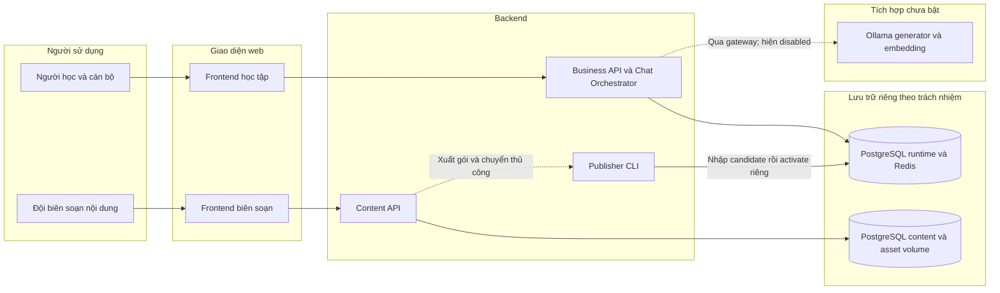

**Cách giải thích:** người học làm việc với Business/Chat. Đội nội dung làm việc với Content API. Dữ liệu tài liệu chỉ đi sang runtime thông qua một bản phát hành cụ thể, không lấy mọi bản nháp để trả lời người học.

## 3. Sơ đồ tổng quan triển khai — các thành phần chạy ở đâu?

Hai project Compose được dùng riêng: `docprep-phase1` và `docprep-content`. Chúng có database, mạng và volume riêng. Việc tách này giúp nhập hoặc sửa tài liệu không tác động trực tiếp đến điểm, bài thi hay tài khoản learner.


Mã Mermaid của sơ đồ triển khai

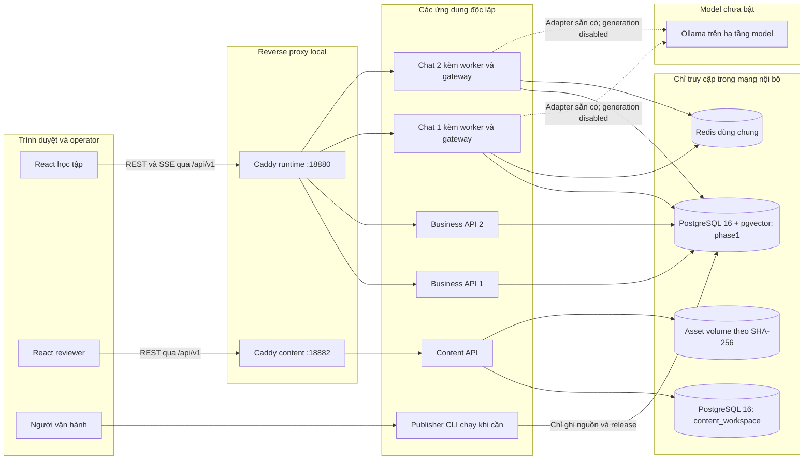

### 3.1. Trách nhiệm của từng ứng dụng

| Ứng dụng | Sở hữu | Ranh giới dữ liệu |
|---|---|---|
| Business API | Auth, consent, hồ sơ, học, đáp án, mastery, thẻ, thi, tiến độ, dashboard, chấp nhận suggestion | Không khởi tạo gateway, không nhận model secrets và không ghi nguồn/release. |
| Chat Orchestrator | Hội thoại, lịch sử, citations, rating, chat/hint/explain, turn, worker và gateway | Không đọc `learner_identity`/`learner_credential`, không ghi điểm, thẻ hoặc bài thi. |
| Content API | Tài khoản content, tài liệu/revision, chunk, nhãn, review, asset và export | Không kết nối runtime DB, không sử dụng token learner. |
| Publisher CLI | Đọc gói đã export; kiểm tra, nhập candidate, activate/revoke | Role `phase_publisher` có quyền nguồn/release tối thiểu, không có quyền dữ liệu learner. |

Mỗi container API/Chat chạy một Uvicorn process. Worker nằm trong lifespan của Chat, không phải một deployment GPU hay một dịch vụ riêng cho từng bước pipeline.

### 3.2. Routing và hợp đồng

- Frontend gọi `/api/v1`; Caddy bỏ `/api` để backend nhận `/v1`.
- Caddy dùng `least_conn`, kiểm tra `/readyz` và flush SSE. Route nhận suggestion do Business xử lý được đặt trước route Chat tổng quát.
- Business và Chat có **60 operations `/v1`: 48 Business, 12 Chat**. Có **7 operation stub trả 501**; không coi mọi operation là chức năng đã hoàn thiện.
- Content OpenAPI có **15 operation**, trong đó 13 thuộc `/v1` và 2 là `/health`, `/readyz`. API này không được cộng vào hợp đồng learner.
- Lỗi có cấu trúc `{error:{code,message_vi,details}}`; access/refresh token, idempotency, SSE và kiểm tra quyền tiếp tục được giữ.
- Cổng 5190 dùng khi phát triển frontend bằng Vite. Cổng local 18880/18882 đang dùng HTTP; không trình bày chúng thành staging HTTPS đã nghiệm thu.

## 4. Chi tiết nghiệp vụ học tập đã triển khai

| Nhóm chức năng | Những phần đã có | Dữ liệu backend quản lý |
|---|---|---|
| Tài khoản | Learner username/mật khẩu, staff login, activation cũ, refresh, logout và role | Token, credential và chủ thể tài khoản. |
| Consent | Đồng ý dịch vụ, kiểm tra consent hiện hành, rút consent và vòng đời tài khoản | Điều kiện được dùng dịch vụ và truy cập AI. |
| Học tập | Danh sách module/unit, phiên học, trả lời, resume, hoàn tất và phiên học ngày | Hàng đợi câu hỏi, cursor và trạng thái phiên. |
| Chấm đáp án | Lưu câu trả lời, tính đúng/sai, cập nhật năng lực, tạo thẻ theo quy tắc | Đáp án chuẩn, kết quả, mastery và hoạt động học. |
| Ôn tập | Deck, thẻ đến hạn, đánh giá lần ôn và lịch FSRS | Due date, số lần ôn, trạng thái ghi nhớ và lịch tiếp theo. |
| Thi thử | Start/resume, autosave, deadline server, submit, results và xem lại | Thời hạn, đáp án lưu, trạng thái nộp và điểm. |
| Tiến độ | Thống kê học, thi, coverage, rhythm/skills và dự đoán ghi nhớ | Dữ liệu tổng hợp từ đáp án, thẻ và activity; dự đoán không phải số đo ghi nhớ thực tế. |
| Dashboard | Tổng hợp và xuất báo cáo, giữ ngưỡng ẩn nhóm nhỏ | Dữ liệu minh họa được phân biệt với dữ liệu thực. |

Luồng ghi đáp án giữ trong một transaction nghiệp vụ: **lưu đáp án → cập nhật mastery → tạo thẻ theo điều kiện → ghi hoạt động**. Không tách bốn bước thành bốn dịch vụ, tránh trạng thái lưu đáp án thành công nhưng các phần phụ thuộc chưa cập nhật.

Các thay đổi tích hợp frontend đã có gồm đăng nhập chung username/mật khẩu, dùng danh mục vấn đề từ API, sửa cách thống kê câu bỏ trống trong demo và giữ các luồng học/thi/chat theo contract backend. Đây là các phần tích hợp đã ghi nhận trong mã nguồn và các báo cáo liên quan; báo cáo này không tuyên bố vừa chạy lại toàn bộ browser learner flows.

## 5. Sơ đồ chi tiết xử lý một lượt AI

Sơ đồ phân biệt nhánh **đang dùng** là generation disabled và nhánh **đã có code, kiểm thử bằng scripted/fake** khi generation được bật phù hợp. FIFO là thứ tự cấp lượt, không cam kết thứ tự hoàn thành.

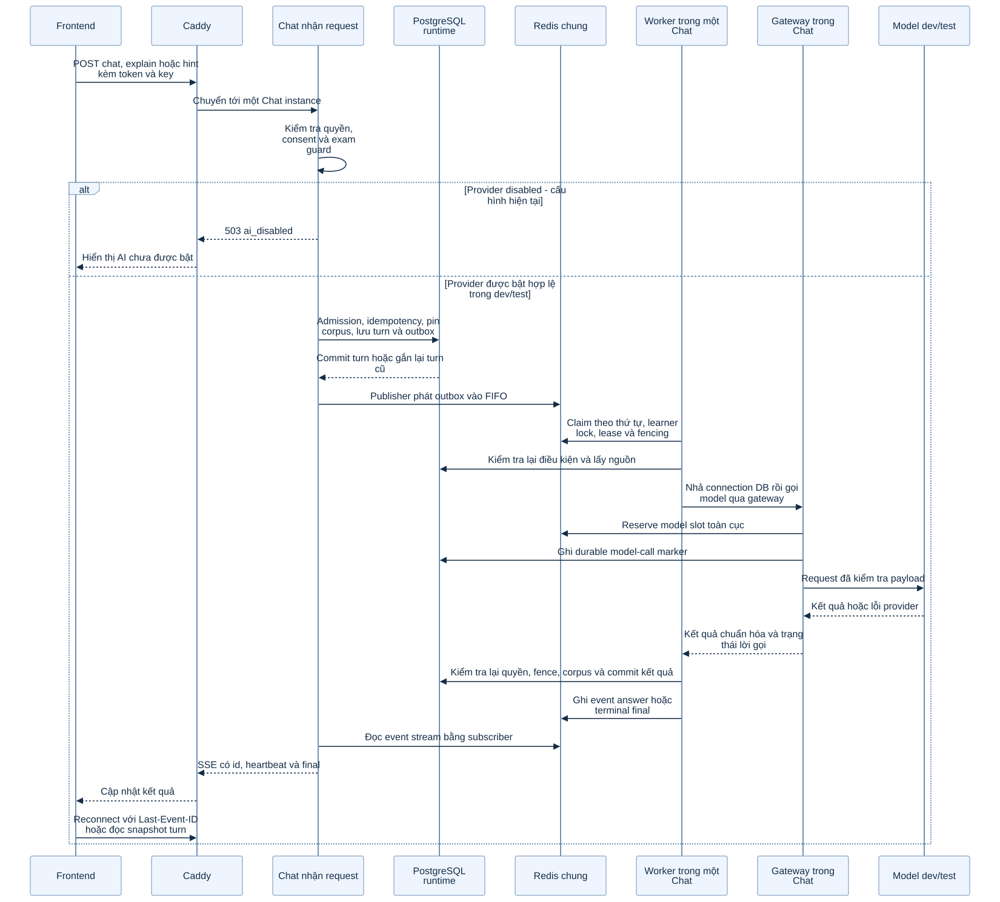

Mã Mermaid của luồng AI

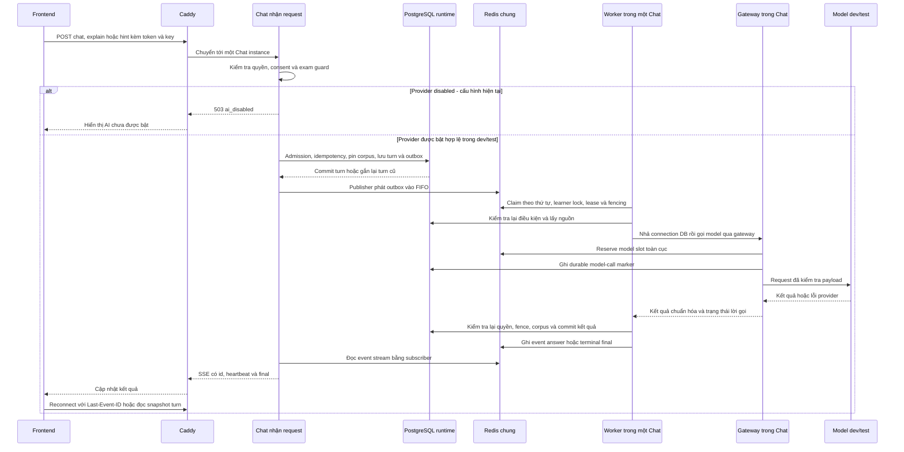

### 5.1. Cơ chế điều phối và phục hồi đã có

| Cơ chế | Hành vi |
|---|---|
| FIFO chung | Hai Chat instances cùng nhận việc từ một queue Redis. |
| Một lượt/learner | Khóa Redis và unique index PostgreSQL bảo vệ một turn chưa kết thúc. |
| Idempotency | Cùng key/payload gắn lại turn; khác payload trả 409. |
| Outbox | Turn và việc cần phát queue được commit cùng transaction PostgreSQL. |
| Fencing | Worker cũ không được ghi kết quả sau khi mất quyền sở hữu lượt. |
| SSE resume | Event có ID, heartbeat và final; client reconnect được qua instance khác. Event hết hạn trả 410 và chuyển sang snapshot PostgreSQL. |
| Hủy | Ngăn công bố kết quả; chỉ nhả model reservation khi lời gọi kết thúc hoặc được xác nhận dừng. |
| Worker chết | Trước invocation marker có thể đưa lại queue; sau marker không tự gọi lại khi trạng thái thực thi chưa xác định. |
| Redis restart | Dừng admission, đối soát và dựng lại điều phối từ PostgreSQL dưới khóa phục hồi. |
| Guard thay đổi | Bắt đầu thi, rút consent, xóa/đóng tài khoản hoặc revoke nguồn làm turn liên quan không còn hợp lệ. |

Các trạng thái turn: `queued → running → completed / failed / cancelled / interrupted`. Chúng khác với bốn trạng thái nội dung AI: `answered`, `insufficient_evidence`, `declined`, `needs_clarification`. Lỗi hạ tầng không được biến thành câu trả lời “thiếu bằng chứng”.

Cấu hình local ban đầu là **1 active turn, 1 model call toàn cục, queue tối đa 20, queue wait 60 giây, turn deadline 360 giây, provider timeout tối đa 300 giây và drain 390 giây**. Đây là chính sách thử nghiệm ứng dụng, không phải năng lực GPU đã đo.

### 5.2. Gateway và retrieval

- Ollama generator/embedding đã được nối qua giao diện gateway; không tự fallback sang nhà cung cấp bên ngoài.
- Retrieval có PostgreSQL full-text, pgvector và RRF; embedding gắn passage, model/digest, corpus version và content hash.
- Index job cũng đi qua outbox, Redis, worker và model reservation chung. Không gọi Ollama trực tiếp ngoài giới hạn tài nguyên.
- Model secrets chỉ cấp cho Chat. Không đưa token, IP hoặc định danh learner vào prompt; log không ghi prompt/output thô. Bộ lọc theo mẫu không bảo đảm nhận diện mọi PII.
- Lần lập báo cáo xác nhận `PHASE_MODEL_PROVIDER=disabled`. Chưa đo chất lượng câu trả lời, tốc độ generator/embedding hoặc khả năng hủy thực tế trên server model.

## 6. Kho tài liệu YHDP và chính sách chấp nhận tạm

### 6.1. Dữ liệu đang có

Nguồn trực tiếp là **`data.zip` do người phụ trách cung cấp**, đọc bảng `chunks` trong **`data/yhdp.db`**. Đây là các đoạn đã được bộ xử lý YHDP chia sẵn; lần tích hợp này không thực hiện OCR hay tự tạo lại 477 đoạn bằng AI.

| Mã | Tên tài liệu trong database nguồn | Số đoạn |
|---|---|---:|
| `qd2760` | Hướng dẫn chẩn đoán, điều trị sốt xuất huyết Dengue | 180 |
| `qd5642` | Hướng dẫn chẩn đoán và điều trị một số bệnh truyền nhiễm | 187 |
| `qd5904` | Hướng dẫn chẩn đoán, điều trị và quản lý một số bệnh không lây nhiễm tại trạm y tế xã | 110 |
| **Tổng** | **3 tài liệu** | **477** |

Có **26 asset**; nhãn nguồn gồm 171 `auto`, 306 `review`. Hai tag không khớp chunk/hash được giữ trong báo cáo nhập, không gán nhầm vào chunk hiện tại. Registry nguồn có thêm mục nhưng chỉ 3 tài liệu có chunk trong SQLite. Chưa có DOCX/PDF gốc nên các revision được ghi `derived_only`.

### 6.2. Sơ đồ chi tiết luồng tài liệu


Mã Mermaid của luồng tài liệu

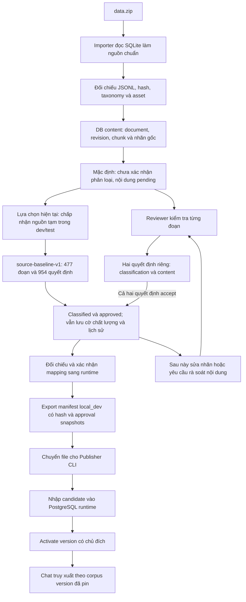

### 6.3. Hai nhóm phân loại và hai quyết định

| Trường | Giá trị | Ý nghĩa |
|---|---|---|
| `classification_status` | `unclassified` / `classified` | Chưa xác nhận hoặc đã chấp nhận bộ nhãn hiện hành. |
| `content_status` | `pending` / `approved` / `needs_revision` / `rejected` | Kết quả xem xét nội dung, độc lập với phân loại. |
| `policy_version` | `human-v1` / `source-baseline-v1` | Căn cứ của quyết định; chấp nhận tạm được phân biệt với review thủ công. |
| `row_version` | Số nguyên tăng khi ghi | Ngăn thao tác trên bản cũ ghi đè thay đổi mới. |

Theo yêu cầu người phụ trách, **477/477 đoạn hiện đã classified + approved theo `source-baseline-v1`**, ghi **954 quyết định** và một audit chấp nhận gói. Nội dung và nhãn gốc không bị sửa. Giao diện hiển thị “Chấp nhận tạm theo dữ liệu nguồn”; đây chưa phải kết quả thẩm định của chuyên gia.

Thao tác chấp nhận tạm chỉ áp dụng local/dev, đúng hash của ZIP đã nhập, kiểm tra nhãn hợp lệ và không ghi đè chunk đã có quyết định. Có preview, transaction, idempotency và backup trước khi apply. Sau này có thể sửa nhãn hoặc ghi quyết định mới; lịch sử cũ được giữ. Muốn sửa text thì cập nhật nguồn và nhập revision mới.

### 6.4. Phát hành và thay đổi giao diện

Đã có export manifest chứa text, location, nhãn, source hash và hai approval snapshots. Publisher kiểm tra rồi tạo candidate; activate là bước riêng. Turn pin corpus version tại admission, kiểm tra lại trước model và commit. Candidate chưa activate không lọt vào retrieval/citation; nguồn revoked bị chặn.

**Trạng thái thực tế:** runtime `phase1` đang có **0 managed release và 0 activation**. Phát hành đã thử trên database `phase1_test`, không tự đưa 477 đoạn vào corpus demo. Mapping nguồn sang runtime chưa được chấp nhận tự động từ thứ tự/tên hoặc từ fixture QA.

Giao diện content đã có lọc tài liệu/hai nhóm, xem nguồn và asset, sửa nhãn, ghi quyết định, lịch sử, export. Cột trái đã giới hạn chiều cao, cuộn riêng, bám theo màn hình desktop, rút preview còn 3 dòng; phân trang luôn ở đáy cột và đổi trang tự về đầu danh sách.

## 7. ERD chi tiết theo miền dữ liệu

### 7.1. Dữ liệu học tập và AI runtime

Sơ đồ dưới đây chọn các bảng chính và quan hệ FK đã có, không liệt kê toàn bộ bảng trong schema. `chat_session` gắn learner bằng `learner_pid` theo kiểm tra nghiệp vụ, không vẽ thành FK trực tiếp. `ai_model_call.turn_id` là tham chiếu logic được giữ khi xóa turn để tránh nhả slot sai; FK đó đã được bỏ trong migration.


Mã Mermaid của ERD runtime

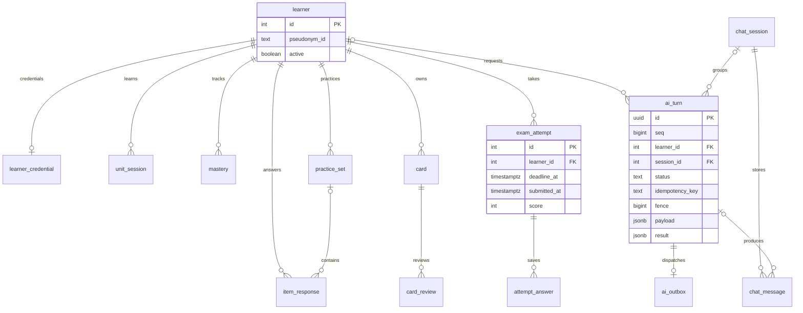

### 7.2. Dữ liệu tài liệu và phân loại

Tài liệu → revision → chunk là trục lưu nguồn. Bộ nhãn và quyết định được lưu riêng, trạng thái hiện hành trỏ về các quyết định tương ứng. Trong DB content không có bảng learner, điểm hoặc bài thi.


Mã Mermaid của ERD content

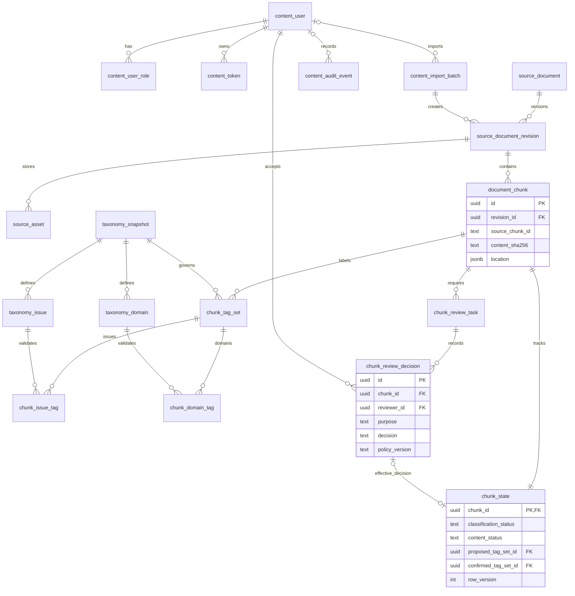

Runtime lưu nguồn được công bố ở `document`, `passage`, `corpus_release`, `corpus_release_member`, `corpus_activation`, `corpus_activation_event`. Member giữ source chunk/revision reference, hash và approval snapshot. Đây là dữ liệu đối soát giữa hai miền; **không có FK xuyên database** và Chat không truy vấn DB content trong mỗi lần trả lời.

## 8. Bảo mật và vận hành đã bổ sung

- Tách role migrator, Business, Chat, publisher và content app/operator. Runtime app không có quyền DDL; tài khoản content có editor/reviewer/publisher và token riêng.
- Kiểm tra chủ sở hữu session/turn/result; kiểm tra consent/exam/account trước xử lý và trước công bố kết quả.
- Password content được hash Argon2id; token content được lưu dạng digest; có refresh/logout/reset và giới hạn thử đăng nhập. Không nhập users/JWT secret/log model từ ZIP nguồn.
- Import giới hạn kích thước ZIP, chặn path traversal/entry trùng, chỉ đọc các bảng/artifact cho phép. Asset lưu theo SHA-256 trên volume, không phục vụ tùy ý đường dẫn filesystem.
- `/health` kiểm tra tiến trình; `/readyz` kiểm tra dependency/schema; metrics nội bộ. Có cấu hình Prometheus/Grafana theo profile, không coi là hệ monitoring production đã nghiệm thu.
- Có script release drain và backup runtime; Compose không tự rolling update. Không dùng `down -v` khi cần giữ dữ liệu.
- Backup content gồm PostgreSQL dump, asset archive và manifest SHA-256. Restore tạo DB/volume mới, không ghi đè workspace.

Backup/restore content đã đối soát **477 chunk, 26 asset và hash khớp** trên DB `content_restore_20261116160100` cùng volume riêng. Backup trước chấp nhận tạm nằm tại `backups/content/20261116162350`. Runtime dump trước migration đã tạo nhưng **không được restore lại trong đợt kiểm chứng content này**.

## 9. Kiểm thử và bằng chứng

Các kết quả dưới đây lấy từ log trong cùng phiên làm việc, không chạy lại toàn bộ suite chỉ để viết báo cáo. Chúng thuộc các mốc thay đổi khác nhau; không cộng dồn các lần chạy trùng thành số chức năng đã nghiệm thu.

| Nhóm | Kết quả | Giới hạn diễn giải |
|---|---|---|
| Content PostgreSQL | **17 passed**, 90,38 giây | Import, review, API/auth, quyền, baseline tạm, export policy và sửa lại sau chấp nhận. |
| Content/API sau chỉnh lock | **4 passed, 13 deselected**, 44,58 giây | Nhóm trọng tâm được chạy lại; nằm trong 17 ca phía trên. |
| Phase 1 | **56 passed**, 121,18 giây | Hai Chat instances, điều phối/phục hồi và publication; provider scripted/fake trong test. |
| Backend regression chọn lọc | **186 passed**, 441,82 giây | 14 file nghiệp vụ, không phải mọi test backend trong repo. |
| Frontend unit | **124 passed**, 0 fail | Bộ unit test frontend tại mốc tích hợp. |
| Reviewer browser | **2 passed** | Build thật + API/DB QA riêng; không fake API thành công. |
| Baseline UI | **Đạt desktop và mobile** | Xác nhận 477/477, nhãn tạm, lịch sử và reload; không sửa dữ liệu trong browser smoke. |
| Sidebar UI | **Đạt 1440×1000, 1366×768, 390×844** | Cuộn riêng, pager đứng yên, sticky desktop, đổi trang reset scroll, xem chi tiết và checkbox; 0 lỗi JavaScript. |
| Build/lint | **Đạt** | Build reviewer có TypeScript check, lint và kiểm tra whitespace. |
| Backup/restore content | **Đạt** | Phục hồi thật vào DB/volume riêng; count/hash/asset đã đối chiếu. |

DB test là `content_workspace_test`, `phase1_test`, `alpha_content_test`, tách khỏi DB demo. Mapping `AUTOMATED-QA-ONLY` và các quyết định trong browser QA chỉ là fixture kiểm tra đường dữ liệu, không dùng làm phê duyệt chuyên môn hay đưa vào runtime đang dùng.

Chi tiết log và cách tái lập xem [báo cáo kiểm chứng content](content-workspace-verification.md). Những ảnh kiểm tra giao diện ở `%TEMP%` là evidence trên máy hiện tại, không phải artifact đã commit cùng source.

## 10. Phần còn lại và hướng tiếp theo

| Hạng mục | Trạng thái hiện tại | Việc cần làm tiếp |
|---|---|---|
| Chất lượng 477 đoạn | Được chấp nhận tạm theo yêu cầu dự án | Có chuyên gia thì rà soát, sửa nhãn/nội dung bằng revision và quyết định mới. |
| Mapping nội dung sang runtime | Có cấu trúc/version và validation | Đối chiếu mapping thực tế; không dùng mapping QA theo thứ tự. |
| Corpus ký số | Local release unsigned `local_dev`; verifier từ chối mặc định | Chốt protocol, thuật toán, khóa và quy trình xác minh; không tự gắn trust verified. |
| Model thật | Adapter có, generation disabled | Khi server bật, kiểm tra kết nối/model rồi đánh giá generation, embedding, health/cancel và resource mapping. Nguồn local chưa verified vẫn bị chặn với Ollama theo code hiện tại. |
| Examiner/reranker | Chưa bật/chưa chốt model | Cần cấu hình được duyệt và kiểm thử riêng; không thay bằng generator một cách tự động. |
| Tải 30/40/50 learners | Có harness và mục tiêu lập kế hoạch | Chạy workload được chốt, thu số đo model thật và tiêu chí chất lượng/SLO. |
| Staging/production | Có nền cấu hình và công cụ local | Hoàn thiện HTTPS, secrets, giám sát, backup schedule, restore/drain/rollback trên môi trường đích. |
| Chức năng ngoài phạm vi | Stub 501 và một số mở rộng vẫn giữ | CSV chuyên môn, OCR/parser mới, phát hành binary asset sang learner, scheduler, auto-classifier mới và garbage collector cần mốc riêng. |

## 11. Nội dung có thể dùng khi báo cáo với Lead

> Em đã tích hợp backend thật cho các luồng tài khoản, học, ôn, thi và tiến độ. Về kiến trúc, Business và Chat chạy độc lập, mỗi loại có hai instances sau Caddy; hai Chat dùng chung Redis để điều phối FIFO và PostgreSQL để lưu trạng thái bền vững, phục hồi khi có lỗi.
>
> Em đã làm thêm kho tài liệu riêng theo dữ liệu YHDP, gồm document, revision, chunk, nhãn và lịch sử duyệt. Hiện có 477 đoạn từ ba tài liệu. Theo thống nhất tạm thời, toàn bộ được chấp nhận làm baseline phát triển, có dấu vết riêng để sau này chuyên gia rà soát lại.
>
> Luồng phát hành nguồn từ content sang runtime đã kiểm tra trên DB test. AI thật đang tắt; nguồn ký số, mapping thực tế, chất lượng model và tải 30–50 learners vẫn cần nghiệm thu tiếp. Vì vậy em trình bày đây là bản tích hợp local/dev có kiểm thử, chưa coi là hoàn tất Phase 1 production.

## 12. Mã nguồn và tài liệu đối chiếu

| Nội dung | Nguồn |
|---|---|
| Tách runtime, routing và Compose | [Business entrypoint](../../backend/app/main_business.py), [Chat entrypoint](../../backend/app/main_chat.py), [Compose Phase 1](../../deploy/compose.phase1.yml), [Caddyfile](../../deploy/Caddyfile) |
| Nghiệp vụ và API | [Kiến trúc](architecture.md), [ma trận API](api-matrix.md), [OpenAPI runtime](../../openapi.yaml), [đăng nhập](password-login.md) |
| Turn, queue và phục hồi | [Admission](../../backend/app/chat/admission.py), [Worker](../../backend/app/chat/worker.py), [Turn API](../../backend/app/api/turns.py), [migration 0013](../../backend/migrations/versions/0013_phase1_turns.py) |
| Gateway và nguồn | [Ollama gateway](../../backend/app/ollama_gateway.py), [corpus scope](../../backend/app/repo/corpus.py), [migration release](../../backend/migrations/versions/0018_corpus_releases.py) |
| Content API và import | [Content entrypoint](../../backend/app/main_content.py), [importer](../../backend/app/content/importer.py), [OpenAPI content](../../openapi.content.yaml), [Compose content](../../deploy/compose.content.yml) |
| Baseline và publication | [Chấp nhận tạm](../../backend/app/content/baseline.py), [publication](../../backend/app/content/publication.py), [runbook content](content-workspace.md) |
| Giao diện reviewer | [React](../../src/content/main.tsx), [CSS](../../src/content/style.css) |
| Test và vận hành | [Kiểm chứng content](content-workspace-verification.md), [backup content](../../scripts/backup-content.py), [chạy local](../../README-RUN-LOCAL.md) |

Các sơ đồ trong báo cáo có mã Mermaid để chỉnh sửa và ảnh SVG để xem trực tiếp; các file nằm tại `docs/phase1/diagrams/implementation-summary/`. Thay đổi URL/role/triển khai sau này cần cập nhật cả sơ đồ và nội dung báo cáo.
